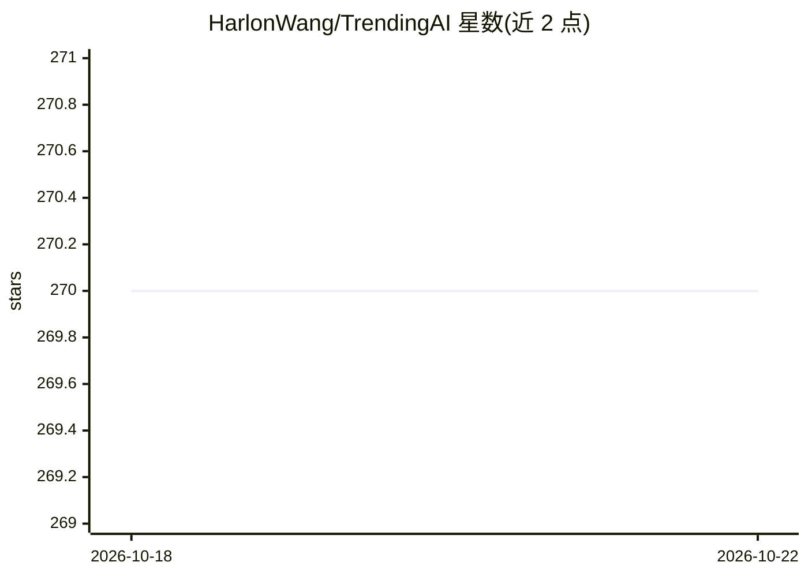

# HarlonWang/TrendingAI

⭐ 270 · Kotlin · MIT · 推送 2026-10-20 · [GitHub](https://github.com/HarlonWang/TrendingAI) · [官网](https://trendingai.cn/app) · 个人维护 · 中文 README

**聚合 GitHub/HN/Product Hunt 热点并附 AI 摘要与精选的跨平台应用**

基于 Kotlin Multiplatform 与 Compose Multiplatform 构建的跨平台应用（Android/iOS/Web），聚合 GitHub Trending、Hacker News、Product Hunt 三个技术热点的数据源，为每个项目自动生成 AI 摘要，并由 AI 每日精选值得关注的项目；支持查看任意日期的历史热门列表。面向希望集中浏览技术热点的普通用户，通过 Google Play、F-Droid、Release 下载及 Obtainium 自动更新分发。

## 筛选速览

| 维度 | 判定 | 备注 |
|---|---|---|
| AI 角色 | `ai-enhanced` | 去掉 AI 部分产品仍成立 |
| 许可风险 | `permissive` | MIT |
| 部署形态 | `None` |  |
| 模型依赖 | — | README 未给出锁定关系 |
| 硬件要求 | — | 无带数字的原话,不猜 |
| 安装摩擦 | `low` | 无编译、无系统依赖或容器化 |
| 成熟度 | — | 结构信号不足 |

## 能力要点

- 单应用聚合 GitHub Trending、Hacker News、Product Hunt 三个数据源
- 每个项目自动生成 AI 分析摘要
- AI 每日精选最值得关注的项目
- 支持查看任意日期的历史热门记录

## 适用场景

- 在一个应用里同时浏览三个技术热点平台
- 通过 AI 摘要快速了解项目核心价值
- 回看某一天的热门项目列表

## 场景标签

`精选清单` · 领域:学习与行业

## 证据(README 行号)

> L29: Trending AI is a cross-platform application built with Kotlin Multiplatform (KMP). It aggregates three major tech s
> L34: - 🤖 **AI Summaries**: Every project gets an automatic AI analysis to help you quickly grasp its core value.
> L35: - ⭐ **Daily Picks**: AI curates the most noteworthy tech projects from across the web.

## 星数曲线

2026-10-18 270 → 2026-10-22 270（+0）

---
*卡片 v1 · prompt 1.4 · 生成 2026-10-22 · 置信度 high · 依据 README sha `c72ee61b3af0` · [字段定义](../../DATASET.md)*
