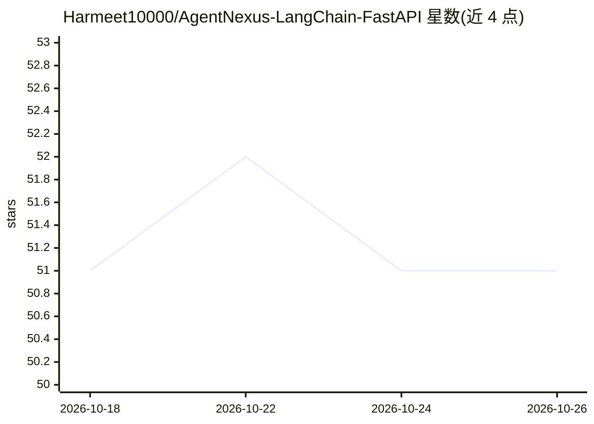

# Harmeet10000/AgentNexus-LangChain-FastAPI

⭐ 51 · Python · MIT · 推送 2026-10-24 · [GitHub](https://github.com/Harmeet10000/AgentNexus-LangChain-FastAPI) · 个人维护

**面向印度合同的人工审核法律智能平台（FastAPI 服务）**

Agent Saul 是基于 FastAPI、LangGraph、LangChain 与 Google Gemini 构建的有状态法律推理系统，针对印度合同场景做条款标注、风险标记、模板比对、印花税与管辖检查等高重复工作，人工审核后方可持久化。架构上采用主规划-工人-反思循环的可恢复编排，检索用 TigerData/Postgres（pgvector/pgvectorscale/pg_textsearch），图记忆用 Neo4j + Graphiti，后台任务用 Celery/Redis。PostgreSQL 为必需依赖（缺失时拒绝启动），Redis/MongoDB/Neo4j 可选降级；需 Google Gemini API key，通过 git clone 源码与 uv 安装运行。

## 筛选速览

| 维度 | 判定 | 备注 |
|---|---|---|
| AI 角色 | `ai-native` | 本体是模型或模型工具 |
| 许可风险 | `permissive` | MIT |
| 部署形态 | `self-host` | docker 或自建部署 |
| 模型依赖 | — | README 未给出锁定关系 |
| 硬件要求 | — | 无带数字的原话,不猜 |
| 安装摩擦 | `low` | 无编译、无系统依赖或容器化 |
| 成熟度 | — | 结构信号不足 |

## 能力要点

- LangGraph 主规划-工人-反思循环的可恢复、有状态工作流
- 人工审核闸门：审批风险、修正条款、留存审计数据后才持久化
- TigerData/Postgres 向量与文本检索 + Neo4j/Graphiti 图记忆
- Docling 解析、Crawl4AI/Tavily 检索工具、Celery 后台执行

## 适用场景

- 对印度合同做条款标注、风险标记与截止日期跟踪
- 中小企业和个人在缺乏法律团队时辅助理解合同条款
- 跨保险、医疗、遗嘱土地等场景做合同合规辅助分析

## 场景标签

`RAG` · 领域:知识与检索

## 证据(README 行号)

> L3: Graph-backed, human-verified legal intelligence for Indian contracts.
> L141: - Indian contract analysis with human verification before trusted persistence
> L172: - LLM layer: LangChain + Google Gemini

## 星数曲线

2026-10-18 51 → 2026-10-26 51（+0）

---
*卡片 v1 · prompt 1.4 · 生成 2026-10-24 · 置信度 mid · 依据 README sha `92ab082e040d` · [字段定义](../../DATASET.md)*
