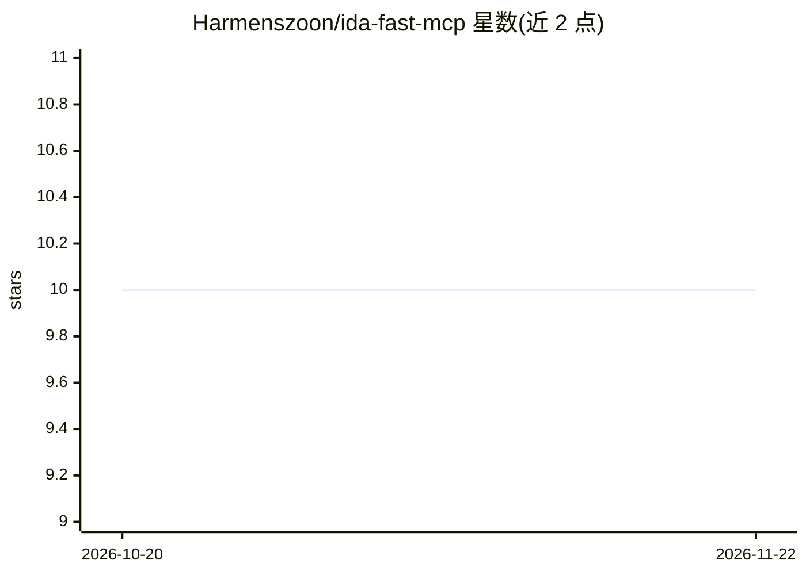

# Harmenszoon/ida-fast-mcp

⭐ 10 · Python · Unlicense · 推送 2026-06-05 · [GitHub](https://github.com/Harmenszoon/ida-fast-mcp) · 个人维护

**给逆向工程师的 IDA Pro MCP 服务器，供 LLM 客户端调用**

以 IDA Pro 插件形式运行的 MCP 服务器，将 IDA 的反编译、交叉引用、字符串/导入导出/类型库查询、字节搜索、符号重命名、类型应用等能力封装为 15 个工具，供 MCP 客户端（LLM）调用。设计围绕控制上下文消耗：精简工具描述、列表分页、类型化声明单一来源生成 schema 与校验；支持最多 20 个 IDA 实例按二进制名路由。仅面向单本地用户，无鉴权，默认绑定 loopback。要求 IDA Pro 9.x 与 Python 3.12+，无第三方依赖。

## 筛选速览

| 维度 | 判定 | 备注 |
|---|---|---|
| AI 角色 | `ai-ecosystem` | LLM/agent 周边工具 |
| 许可风险 | `permissive` | Unlicense |
| 部署形态 | `None` |  |
| 模型依赖 | — | README 未给出锁定关系 |
| 硬件要求 | — | 无带数字的原话,不猜 |
| 安装摩擦 | `low` | 无编译、无系统依赖或容器化 |
| 成熟度 | — | 结构信号不足 |

## 能力要点

- 15 个无重叠工具（含 run_python 逃生通道）供 MCP 客户端调用
- 多实例路由：最多 20 个 IDA 实例按二进制名定向调用
- 列表分页与类型化声明单一来源，控制上下文 token 消耗
- 单文件插件部署，无第三方依赖

## 适用场景

- 让支持 MCP 的 LLM 客户端读取和分析 IDA 中的二进制
- 通过自然语言驱动的逆向工程工作流批量查询函数与引用
- 同时分析多个二进制并从单一客户端切换目标实例

## 场景标签

 · 领域:安全/逆向工程工具

## 证据(README 行号)

> L3: MCP server for IDA Pro. Built for automated reverse engineering.
> L14: - **15 tools** — no redundancy, no overlap, clear verbs (`get_`, `list_`, `find_`, `set_`, `apply_`, `define_`) plu

## 星数曲线

2026-10-20 10 → 2026-11-22 10（+0）

---
*卡片 v1 · prompt 1.4 · 生成 2026-11-20 · 置信度 high · 依据 README sha `523abb5c3698` · [字段定义](../../DATASET.md)*
