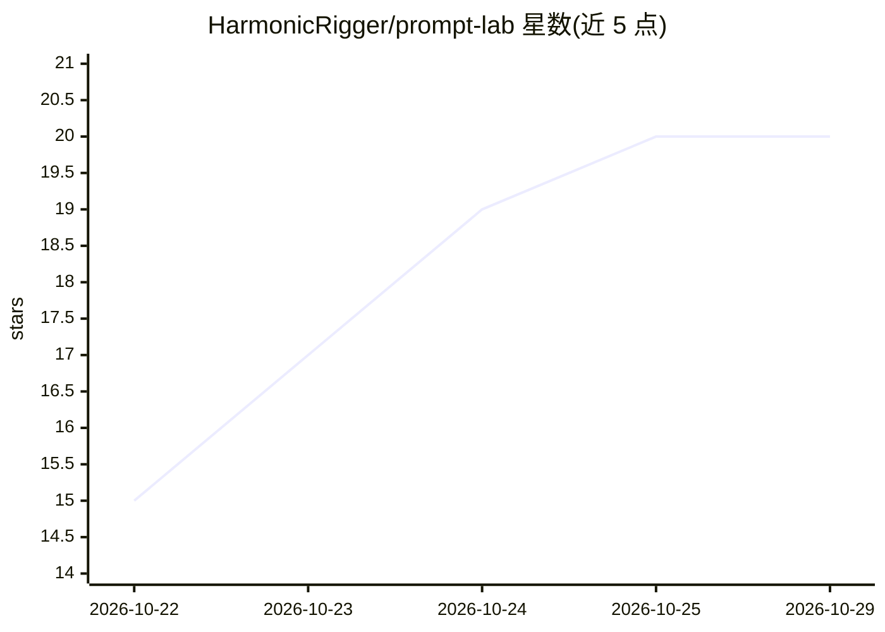

# HarmonicRigger/prompt-lab

⭐ 20 · C# · MIT · 推送 2026-10-18 · [GitHub](https://github.com/HarmonicRigger/prompt-lab) · 个人维护

**Windows 本地模型的提示词测试台：变量矩阵、版本对比、批量运行**

面向本地模型使用者的提示词测试工具：以 {{topic}}、{{tone}} 等占位符编写提示词，按变量矩阵批量测试并与多模型交叉，输出汇总到结果网格；每次编辑保存为修订版，提供并排版本对比与同输入下新旧提示词输出对照，可打快速评分标签。支持导入 CSV/JSON 测试用例，运行历史带时间戳与完整输出、可搜索。以 100 MB 便携自包含 exe 分发（捆绑运行时与推理后端，离线运行，发布附 SHA-256），也可用 .NET 8 SDK 从源码构建；仅支持 Windows 10/11 x64。

## 筛选速览

| 维度 | 判定 | 备注 |
|---|---|---|
| AI 角色 | `ai-ecosystem` | LLM/agent 周边工具 |
| 许可风险 | `permissive` | MIT |
| 部署形态 | `None` |  |
| 模型依赖 | — | README 未给出锁定关系 |
| 硬件要求 | — | 无带数字的原话,不猜 |
| 安装摩擦 | `medium` | 含编译或系统依赖之一 |
| 成熟度 | — | 结构信号不足 |

## 能力要点

- {{占位符}} 变量槽与变量矩阵批量测试，可跨模型交叉
- 提示词修订历史与并排版本 diff
- CSV/JSON 测试用例导入与可搜索的运行历史
- 100 MB 自包含便携 exe，离线运行，发布附 SHA-256 校验

## 适用场景

- 对本地模型批量测试不同提示词版本的效果
- 用 CSV 测试用例集做回归式提示词评测
- 在新旧提示词间做同输入对照并打分

## 场景标签

`提示工程` · 领域:Agent 开发

## 证据(README 行号)

> L3: 🧪 Free, open-source prompt testing bench for local models on Windows — variables, version diffs, batch runs. 100 MB 
> L13: - ✅ **Batch matrix runs** — variables crossed with models, outputs collected in one result grid

## 星数曲线

2026-10-22 15 → 2026-10-29 20（+5）

---
*卡片 v1 · prompt 1.4 · 生成 2026-10-28 · 置信度 high · 依据 README sha `aaafc1d84d07` · [字段定义](../../DATASET.md)*
