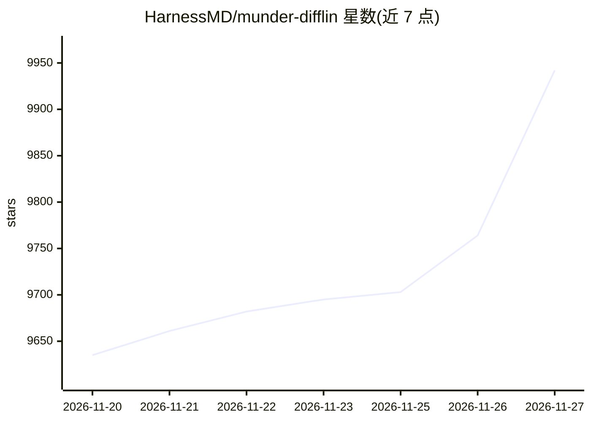

# HarnessMD/munder-difflin

⭐ 9,942 · TypeScript · MIT · 推送 2026-11-26 · [GitHub](https://github.com/HarnessMD/munder-difflin) · [官网](https://munderdiffl.in) · 组织维护

**桌面应用：在自有订阅的 CLI 上编排一支 AI agent 办公室团队**

跨平台桌面应用（Electron），将多个 agent CLI 引擎作为终端进程（node-pty/xterm.js）运行在一个可视化“办公室”里：用户雇佣 agent、指定角色/模型，编排器 Michael 接收请求并分派任务。agent 之间通过本地 git 仓库（outbox/inbox 邮箱机制）通信，共享可搜索记忆，支持定时/ webhook 触发、MCP 工具、Slack 集成、熔断器与 token 上限。不销售模型访问，复用用户已有订阅登录；发布仅源码，需自行构建。

## 筛选速览

| 维度 | 判定 | 备注 |
|---|---|---|
| AI 角色 | `ai-ecosystem` | LLM/agent 周边工具 |
| 许可风险 | `permissive` | MIT |
| 部署形态 | `library` | 以包/库形式分发 |
| 模型依赖 | local-ok | 支持本地模型 |
| 硬件要求 | — | 无带数字的原话,不猜 |
| 安装摩擦 | `low` | 无编译、无系统依赖或容器化 |
| 成熟度 | — | 结构信号不足 |

## 能力要点

- 12 种引擎 CLI 混编于同一办公室，每个 agent 可自选引擎
- hive 机制：本地 git 仓库文件作为 agent 间邮箱通信
- 熔断器监控循环/错误风暴/支出失控，可设每 agent token 上限
- 定时与 webhook 触发、MCP 服务器与技能目录、Slack 线程回传

## 适用场景

- 用已有的 Claude/ChatGPT 等订阅在本机同时运行多个 agent 协作
- 给不同 agent 配置角色与模型处理研究/写作/代码等任务
- 通过任务板与 Ask me 审批流监督 agent 团队的执行过程

## 场景标签

`多智能体` · 领域:Agent 开发

## 证据(README 行号)

> L20: Munder Difflin is a desktop app that runs a team of AI agents as an office you can watch. You hire
> L24: - **Your subscriptions.** Each agent runs the real CLI you already use, signed in with your own plan.
> L53: API keys and local models (Ollama, LM Studio, vLLM) go in **Settings → Agents & Models**. A missing CLI

## 星数曲线

2026-11-20 9,635 → 2026-11-27 9,942（+307）

---
*卡片 v1 · prompt 1.4 · 生成 2026-11-20 · 置信度 high · 依据 README sha `d06eb7bf3a88` · [字段定义](../../DATASET.md)*
