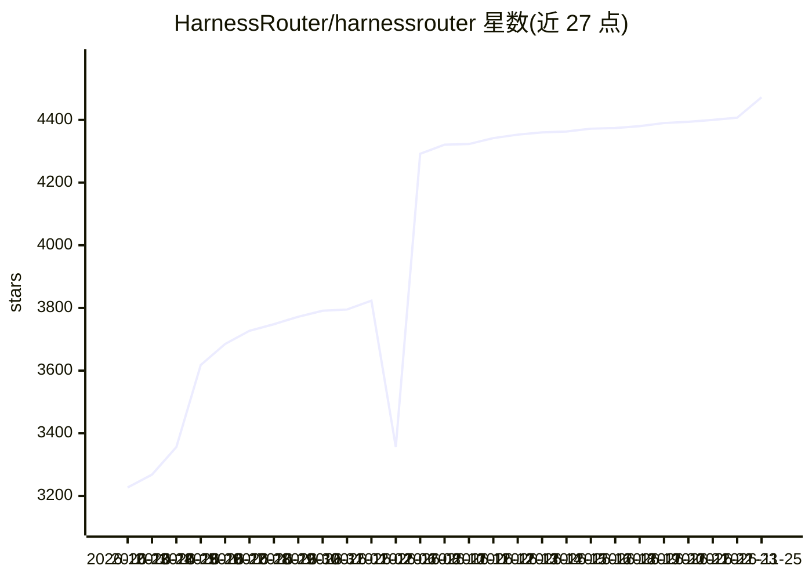

# HarnessRouter/harnessrouter

⭐ 4,472 · Python · Apache-2.0 · 推送 2026-11-23 · [GitHub](https://github.com/HarnessRouter/harnessrouter) · [官网](https://harnessrouter.ai/) · 组织维护

**为构建 agent 产品的开发者提供统一的 agent harness 接入 API**

自托管的 agent harness 基础设施层：将 Codex、Claude Code 等多个 agent harness 转为可插拔后端，产品通过一个 OpenAI Responses 兼容 API 运行任务、获取结果并切换 harness。实现 Unified Harness Protocol (UHP)，处理持久会话、流式进度、文件、取消、幂等重试（Idempotency-Key）与结构化失败。以 Docker 镜像分发，需自带 provider API key，无内置模型；Apache-2.0 许可，另有托管 Cloud 版。

## 筛选速览

| 维度 | 判定 | 备注 |
|---|---|---|
| AI 角色 | `ai-ecosystem` | LLM/agent 周边工具 |
| 许可风险 | `permissive` | Apache-2.0 |
| 部署形态 | `self-host` | docker 或自建部署 |
| 模型依赖 | — | README 未给出锁定关系 |
| 硬件要求 | — | 无带数字的原话,不猜 |
| 安装摩擦 | `low` | 无编译、无系统依赖或容器化 |
| 成熟度 | — | 结构信号不足 |

## 能力要点

- 一个 API 接入多个 harness，metadata.harness_id 选择后端，31 种 harness 列出
- OpenAI Responses 兼容接口，支持会话、SSE 流式、文件、取消与幂等重试
- W3C Trace Context 追踪头透传与 vault 密钥引用/脱敏机制
- 提供 Slides/Sheets/Dashboards/Videos 等 Starter Kit 示例

## 适用场景

- 把 agent harness 作为后端嵌入自家产品的 agent 功能
- 在多个 harness 和模型配置间切换以比较成本与延迟
- 自托管基础设施上运行内容生成、数据分析、SQL 查询等知识型 agent 任务

## 场景标签

`Agent 框架` · 领域:Agent 开发

## 证据(README 行号)

> L16: **Build agent products without handling harness engineering.** HarnessRouter is the infrastructure layer that turns
> L26: HarnessRouter implements the Unified Harness Protocol (UHP) and provides an OpenAI Responses-compatible API, handli

## 星数曲线

2026-10-23 3,227 → 2026-11-25 4,472（+1,245）

---
*卡片 v1 · prompt 1.4 · 生成 2026-11-22 · 置信度 high · 依据 README sha `d015c2ceda87` · [字段定义](../../DATASET.md)*
