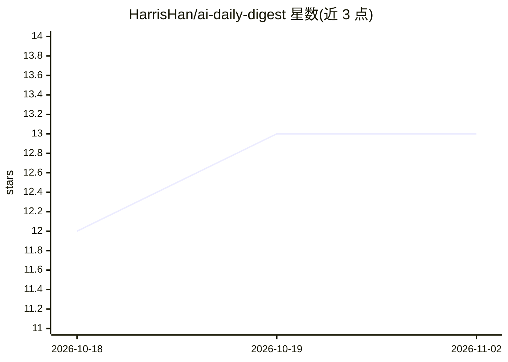

# HarrisHan/ai-daily-digest

⭐ 13 · JavaScript · 推送 2026-02-25 · [GitHub](https://github.com/HarrisHan/ai-daily-digest) · 个人维护

**OpenClaw 技能：抓取 92 个博客 RSS 生成 AI 每日摘要**

面向 OpenClaw agent 的技能插件：从 Karpathy 精选的 92 个技术博客 RSS 源并发抓取（15 路并行），按时间参数过滤后由 agent 自身 LLM 对文章做相关性/质量/时效打分，再生成 2-3 句摘要，输出为日报消息（可发 Telegram）。无需外部 API key，依赖 agent 所配模型（Claude/Gemini/GPT 均可）。通过 clawhub 一键安装或 git clone 手动安装，支持 cron 定时触发与自定义 RSS 源。

## 筛选速览

| 维度 | 判定 | 备注 |
|---|---|---|
| AI 角色 | `ai-ecosystem` | LLM/agent 周边工具 |
| 许可风险 | `none` | — |
| 部署形态 | `None` |  |
| 模型依赖 | — | README 未给出锁定关系 |
| 硬件要求 | — | 无带数字的原话,不猜 |
| 安装摩擦 | `low` | 无编译、无系统依赖或容器化 |
| 成熟度 | — | 结构信号不足 |

## 能力要点

- RSS → 打分 → 摘要的流水线，复用 agent 自带 LLM，零外部 API key
- 92 个 RSS 源（来自 Hacker News Popularity Contest 2025）
- 支持时间范围参数（如 /digest 48h）与 cron 定时任务

## 适用场景

- 让我的 OpenClaw 助手每天早上推送 AI/技术圈日报
- 追踪指定技术博客的更新并获取摘要
- 自定义 RSS 源构建个人日报流

## 场景标签

`网页抓取` `AI 写作` · 领域:效率与自动化

## 证据(README 行号)

> L5: **No external API keys required.** Uses the OpenClaw agent's own LLM for scoring and summarization — works with Clau
> L12: clawhub install ai-daily-digest
> L31: 92 RSS Feeds → Concurrent Fetch → Time Filter → LLM Scoring → LLM Summary → Digest

## 星数曲线

2026-10-18 12 → 2026-11-02 13（+1）

---
*卡片 v1 · prompt 1.4 · 生成 2026-10-31 · 置信度 mid · 依据 README sha `145d886d48b4` · [字段定义](../../DATASET.md)*
