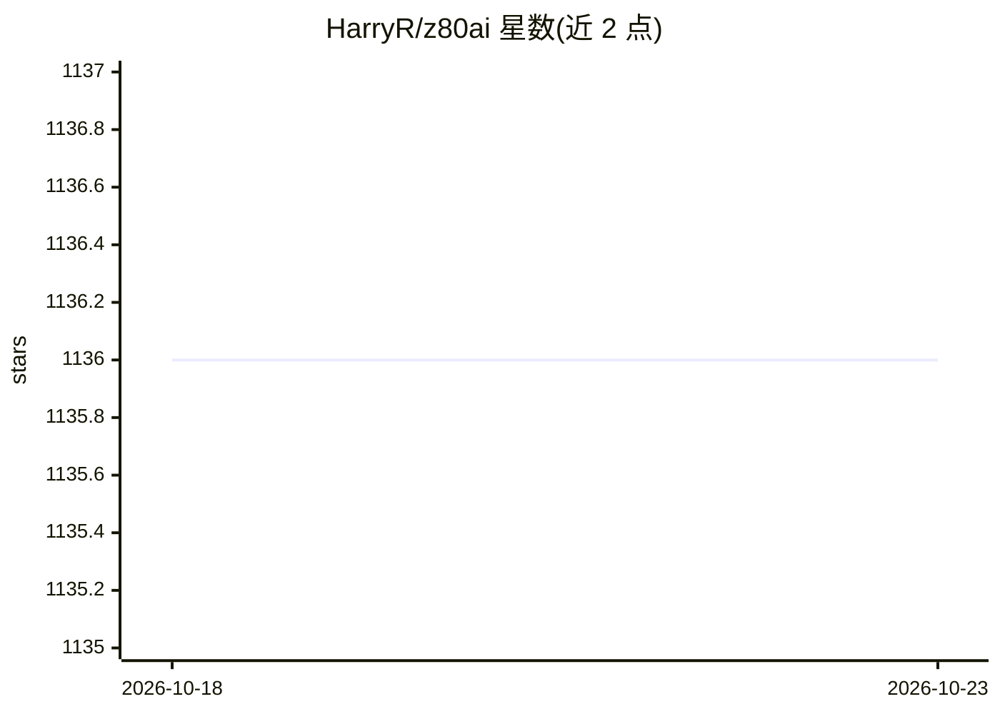

# HarryR/z80ai

⭐ 1,136 · Python · 推送 2026-04-29 · [GitHub](https://github.com/HarryR/z80ai) · 个人维护

**运行在 Z80 复古计算机上的 2-bit 量化微型对话模型**

面向复古计算爱好者的微型语言模型：以 Python 进行量化感知训练（QAT），权重为 2-bit（每字节打包 4 个），推理全部使用 Z80 原生 16 位整数运算，导出为约 40KB 的 CP/M .COM 或 ZX Spectrum .TAP 二进制（含推理、权重与聊天 UI），可在 4MHz、64KB 内存的 8 位 Z80 处理器上逐字符自回归生成回复。输入经 trigram 哈希到 128 个桶，容错拼写与词序，但无法理解语法或深层的多轮上下文。附带两个预训练示例（闲聊与 20 问游戏），及用 Ollama 或 Claude API 生成训练数据的工具。MIT/Apache-2.0 双许可。

## 筛选速览

| 维度 | 判定 | 备注 |
|---|---|---|
| AI 角色 | `ai-native` | 本体是模型或模型工具 |
| 许可风险 | `permissive` | — |
| 部署形态 | `None` |  |
| 模型依赖 | — | README 未给出锁定关系 |
| 硬件要求 | — | 无带数字的原话,不猜 |
| 安装摩擦 | `low` | 无编译、无系统依赖或容器化 |
| 成熟度 | — | 结构信号不足 |

## 能力要点

- 2-bit 量化权重（{-2,-1,0,+1}，每字节打包 4 个），QAT 训练
- 约 40KB .COM 文件含推理代码、权重与聊天式 UI，运行于 1976 年的 4MHz Z80
- 纯 16 位整数运算，无浮点，ReLU 激活，逐字符自回归生成
- 支持 CP/M 与 ZX Spectrum 48K，另含用 LLM 生成训练数据的工具

## 适用场景

- 在 CP/M 或 ZX Spectrum 真机/模拟器上运行微型聊天机器人
- 训练并部署自己的复古计算机对话模型
- 学习极端量化与 8 位硬件推理的实现

## 场景标签

`聊天机器人` `推理引擎` `模型量化` · 领域:对话与助手

## 证据(README 行号)

> L3: Z80-μLM is a 'conversational AI' that generates short character-by-character sequences, with quantization-aware trai
> L65: - **Autoregressive generation**: Outputs text character-by-character

## 星数曲线

2026-10-18 1,136 → 2026-10-23 1,136（+0）

---
*卡片 v1 · prompt 1.4 · 生成 2026-10-21 · 置信度 high · 依据 README sha `19f484ee2f37` · [字段定义](../../DATASET.md)*
