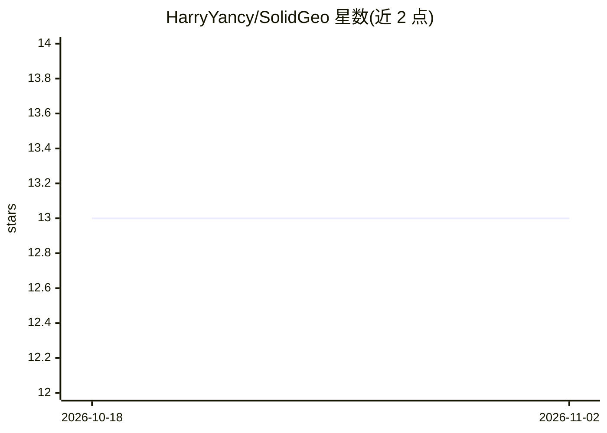

# HarryYancy/SolidGeo

⭐ 13 · Python · NOASSERTION · 推送 2025-11-20 · [GitHub](https://github.com/HarryYancy/SolidGeo) · [官网](https://huggingface.co/datasets/HarryYancy/SolidGeo) · 组织维护

**立体几何多模态空间数学推理基准数据集（3,113 题）**

面向多模态大语言模型（MLLM）评测的立体几何基准：收录 3,113 道 K-12 与竞赛级真实题目，每题配视觉上下文，标注 3 个难度等级与 8 个细分类别（投影、展开、空间度量、空间向量等）。论文报告了 25 个 MLLM 的实验结果，观察到模型与人类能力存在明显性能差距。数据以 JSON 格式提供，含题干、选项等字段，托管于 Hugging Face，附排行榜与可视化页面。

## 筛选速览

| 维度 | 判定 | 备注 |
|---|---|---|
| AI 角色 | `ai-knowledge` | 知识聚合/清单类 |
| 许可风险 | `none` | NOASSERTION |
| 部署形态 | `None` |  |
| 模型依赖 | — | README 未给出锁定关系 |
| 硬件要求 | — | 无带数字的原话,不猜 |
| 安装摩擦 | `low` | 无编译、无系统依赖或容器化 |
| 成熟度 | — | 结构信号不足 |

## 能力要点

- 3,113 道真实 K-12 与竞赛级立体几何题目
- 3 个难度等级与 8 个细分类别标注
- 覆盖投影、展开、空间度量、空间向量等 3D 推理主题
- 对 25 个 MLLM 进行了实验评测并提供排行榜

## 适用场景

- 评测多模态大模型的立体几何空间推理能力
- 研究模型在 3D 数学推理上与人类的性能差距
- 为几何推理与空间智能研究提供测试题库

## 场景标签

`模型评测` · 领域:评测与运维

## 证据(README 行号)

> L10: **SolidGeo** is the first large-scale benchmark specifically designed to evaluate the performance of MLLMs on mathe
> L14: Performance of six MLLMs on SolidGeo benchmark across 8 solid geometry subjects (left), and trade-off between accur

## 星数曲线

2026-10-18 13 → 2026-11-02 13（+0）

---
*卡片 v1 · prompt 1.4 · 生成 2026-10-31 · 置信度 high · 依据 README sha `dbf4ee7b8b3a` · [字段定义](../../DATASET.md)*
