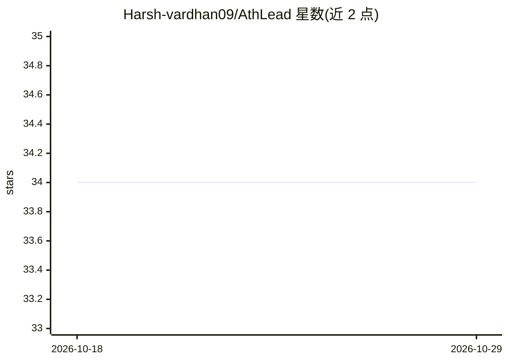

# Harsh-vardhan09/AthLead

⭐ 34 · JavaScript · GPL-3.0 · 推送 2026-10-26 · [GitHub](https://github.com/Harsh-vardhan09/AthLead) · [官网](https://athlead-frontend.onrender.com) · 个人维护

**面向运动员与教练的体育人才发现与排名平台（SIH 2025）**

为印度 Smart India Hackathon 2025 构建的 Web 平台：运动员或教练注册登录后录入表现数据，由训练好的 ML 模型生成表现评分并在仪表盘可视化展示；另含全国排名、活动管理、公告（部委政策与招募）与基于角色的权限系统（运动员/教练/球探/管理员）。前端 React(Vite)+Tailwind，后端 Node.js/Express+MongoDB，ML 部分为 FastAPI+OpenCV/MediaPipe/TensorFlow/PyTorch（README 标注为 planned integration）。提供在线演示链接，未给出安装命令。

## 筛选速览

| 维度 | 判定 | 备注 |
|---|---|---|
| AI 角色 | `ai-enhanced` | 去掉 AI 部分产品仍成立 |
| 许可风险 | `viral` | GPL-3.0 |
| 部署形态 | `None` |  |
| 模型依赖 | — | README 未给出锁定关系 |
| 硬件要求 | — | 无带数字的原话,不猜 |
| 安装摩擦 | `low` | 无编译、无系统依赖或容器化 |
| 成熟度 | — | 结构信号不足 |

## 能力要点

- 注册登录后录入表现数据，ML 模型生成表现评分
- 评分在 Dashboard 可视化，含全国排名
- 角色化访问：运动员、教练、球探、管理员
- ML 微服务技术栈为 Python+FastAPI+OpenCV/MediaPipe（README 标注为计划集成）

## 适用场景

- 运动员录入表现数据并查看 AI 生成的评分与可视化
- 教练与球探查看全国排名发现人才
- 管理员发布活动、公告与部委政策更新

## 场景标签

 · 领域:体育/人才发现平台

## 证据(README 行号)

> L3: ***Athlead is an AI-powered sports talent discovery & ranking platform built for SIH 2025 — Ministry of Youth Affair
> L5: *The main goal of this project is to allow users (athletes or coaches) to **register, log in securely, input perform
> L42: ### ML / AI *(planned integration)*
> L44: - **Python + FastAPI** — ML inference microservice

## 星数曲线

2026-10-18 34 → 2026-10-29 34（+0）

---
*卡片 v1 · prompt 1.4 · 生成 2026-10-25 · 置信度 mid · 依据 README sha `4f11e76f461e` · [字段定义](../../DATASET.md)*
