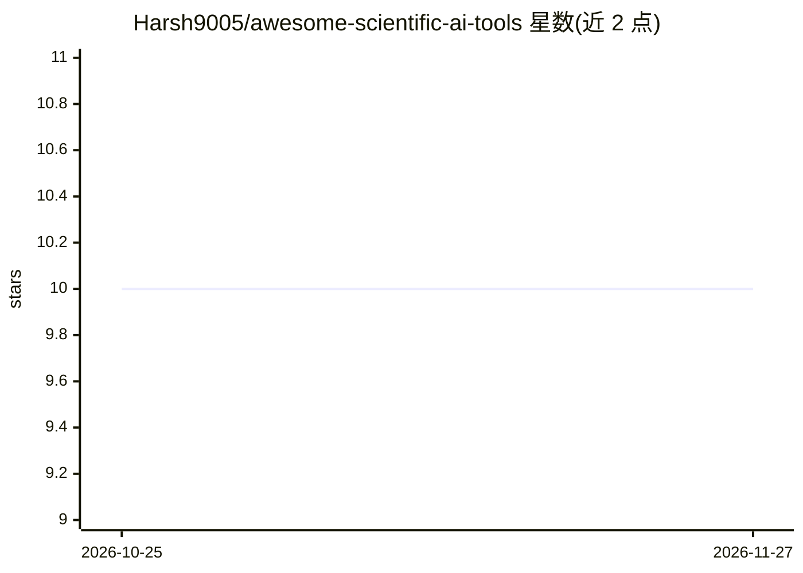

# Harsh9005/awesome-scientific-ai-tools

⭐ 10 · CC0-1.0 · 推送 2026-05-15 · [GitHub](https://github.com/Harsh9005/awesome-scientific-ai-tools) · 个人维护

**科研工作流 AI 工具策展清单：从文献检索到投稿**

按科研流程（发现→阅读→写作→分析→计算→自动化→发表→资助→协作）组织的策展清单，收录 AI 工具、MCP 服务器与 agent 技能。收录条件限定为工具/服务器/技能（不含论文、数据集或模型权重）、活跃维护、提供免费档或学术广泛使用。两个特色板块：科研数据库的 MCP 桥接（PubMed、arXiv、ChEMBL 等）与面向 Claude Code、Cursor 等 coding agent 的科研技能插件。提供多语言版本。

## 筛选速览

| 维度 | 判定 | 备注 |
|---|---|---|
| AI 角色 | `ai-knowledge` | 知识聚合/清单类 |
| 许可风险 | `viral` | CC0-1.0 |
| 部署形态 | `None` |  |
| 模型依赖 | — | README 未给出锁定关系 |
| 硬件要求 | — | 无带数字的原话,不猜 |
| 安装摩擦 | `low` | 无编译、无系统依赖或容器化 |
| 成熟度 | — | 结构信号不足 |

## 能力要点

- 收录科研数据库的 MCP 服务器（PubMed/arXiv/ChEMBL/ClinicalTrials 等）
- 面向 Claude Code、Cursor、Codex 的科研 agent 技能与插件板块
- 条目按科研工作流阶段排序并附收录标准
- 覆盖文献检索、引文管理、写作、数据分析、药物发现等约 17 个类别

## 适用场景

- 为科研各环节挑选 AI 工具（文献综述、论文写作、投稿）
- 为 coding agent 查找科研领域的 MCP 服务器与技能
- 了解科研 AI 工具生态的类目覆盖

## 场景标签

`精选清单` `科研工具` · 领域:学习与行业

## 证据(README 行号)

> L7: This list focuses on tools researchers use *in their workflow* — searching literature, reading papers, writing manus
> L11: ## MCP Servers for Research
> L24: ## AI Agent Skills & Plugins

## 星数曲线

2026-10-25 10 → 2026-11-27 10（+0）

---
*卡片 v1 · prompt 1.4 · 生成 2026-11-20 · 置信度 high · 依据 README sha `4e5cce4d0f00` · [字段定义](../../DATASET.md)*
