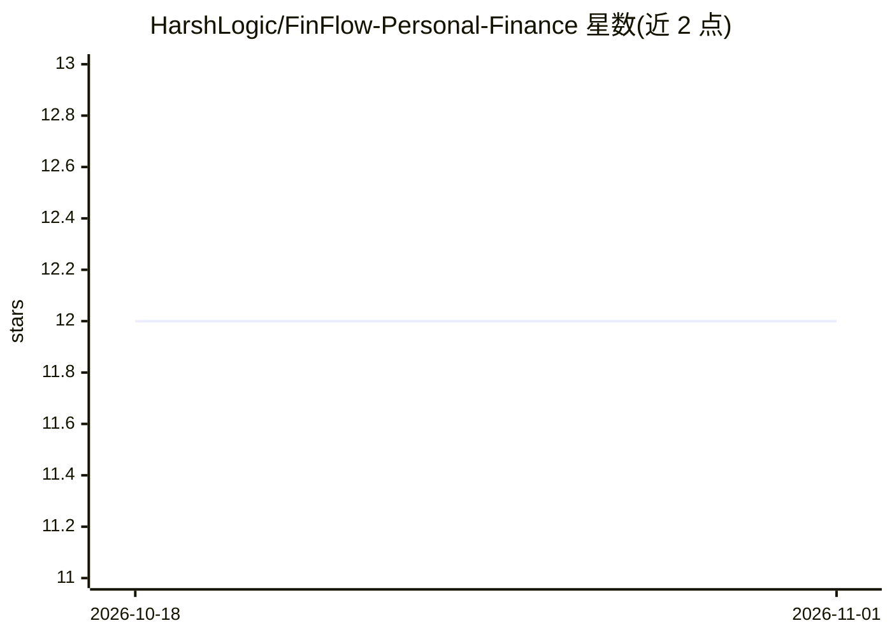

# HarshLogic/FinFlow-Personal-Finance

⭐ 12 · JavaScript · MIT · 推送 2026-10-04 · [GitHub](https://github.com/HarshLogic/FinFlow-Personal-Finance) · [官网](https://finflowpr.vercel.app/) · 个人维护

**MERN 个人财务应用：记录支出、管理投资并预测未来财富**

基于 MongoDB/Express/React/Node 的全栈个人理财应用：支持支出记录与 Need/Want 分类、股票/基金/定存/现金四类资产追踪、基于复利公式的 SIP 财富预测（服务端 API 计算）、50-30-20 预算健康度指标、JWT 认证与按用户数据隔离，并内置基于 Finance Flow 数据的浮动式 AI 聊天助手，可用自然语言查询总资产等。README 标注项目处于活跃开发中，部分模块（如月度预算邮件提醒）为计划项。需 Node.js 18+、npm 9+ 与 MongoDB Atlas，本地分别启动前后端开发服务器运行。

## 筛选速览

| 维度 | 判定 | 备注 |
|---|---|---|
| AI 角色 | `ai-enhanced` | 去掉 AI 部分产品仍成立 |
| 许可风险 | `permissive` | MIT |
| 部署形态 | `library` | 以包/库形式分发 |
| 模型依赖 | — | README 未给出锁定关系 |
| 硬件要求 | — | 无带数字的原话,不猜 |
| 安装摩擦 | `low` | 无编译、无系统依赖或容器化 |
| 成熟度 | `idea` | |

## 能力要点

- 支出/股票/基金/定存/现金五类数据管理与服务端 SIP 复利财富预测
- 50-30-20 预算规则健康度指标与 Need/Want 分类分析
- 基于应用数据回答自然语言问题的 AI 助手聊天机器人
- JWT 认证、Google OAuth 登录与按用户数据隔离

## 适用场景

- 日常记录支出并按 Need/Want 分析消费结构
- 追踪股票、基金、定存等资产并查看整体财富快照
- 用 SIP 计算器按月投入与回报率预测长期财富增长
- 通过聊天助手用自然语言查询自己的资产数据

## 场景标签

`聊天机器人` · 领域:对话与助手

## 证据(README 行号)

> L36: |🤖 Build AI Agent|✅ Complete|Interactive Finance Flow Chatbot|
> L99: - Interactive floating chatbot trained on Finance Flow data

## 星数曲线

2026-10-18 12 → 2026-11-01 12（+0）

---
*卡片 v1 · prompt 1.4 · 生成 2026-11-01 · 置信度 high · 依据 README sha `cf55a7770d22` · [字段定义](../../DATASET.md)*
