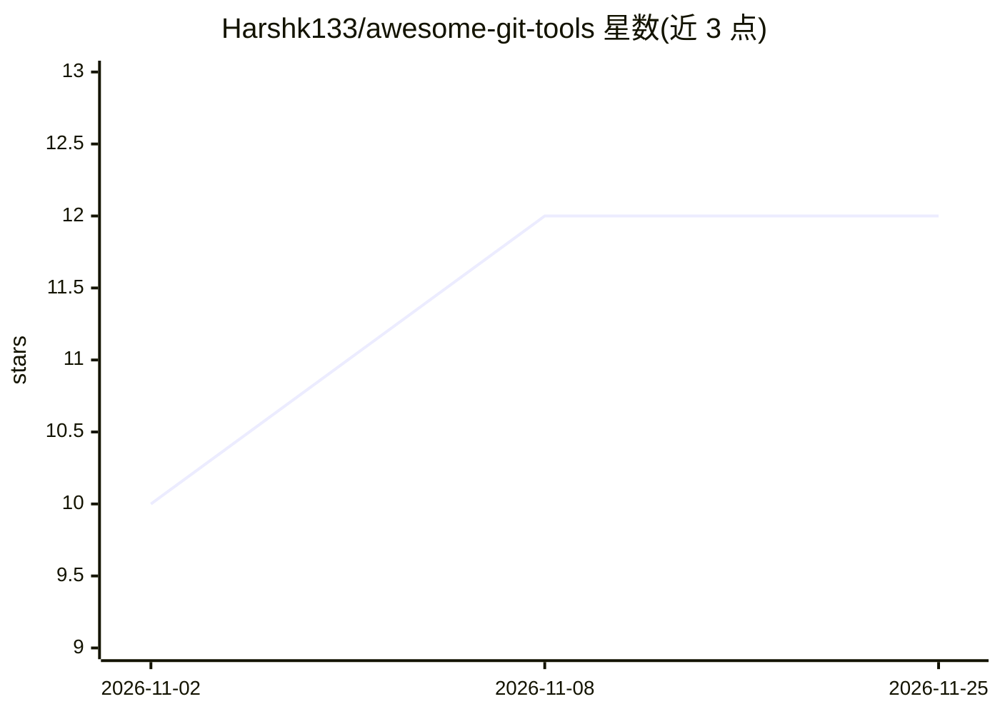

# Harshk133/awesome-git-tools

⭐ 12 · MIT · 推送 2026-09-18 · [GitHub](https://github.com/Harshk133/awesome-git-tools) · 个人维护

**面向开发者的 Git 与 GitHub 工具策展清单**

按类别组织的 Git/GitHub 工具聚合清单，收录约 20 个第三方网站与工具链接，分为仓库探索（如 GitIngest、GitDiagram）、AI 助手（GitHub Chat、Google CodeWiki、Ami）、开发环境（github.dev、VSCode.dev、CodeSandbox、GitMCP）、可视化（RepoBeats）与 GitHub 个人主页生成（GPRM）等板块。每条目附一句功能说明与网址，通过 Pull Request 接受社区补充，采用 MIT 许可。

## 筛选速览

| 维度 | 判定 | 备注 |
|---|---|---|
| AI 角色 | `ai-knowledge` | 知识聚合/清单类 |
| 许可风险 | `permissive` | MIT |
| 部署形态 | `None` |  |
| 模型依赖 | — | README 未给出锁定关系 |
| 硬件要求 | — | 无带数字的原话,不猜 |
| 安装摩擦 | `low` | 无编译、无系统依赖或容器化 |
| 成熟度 | — | 结构信号不足 |

## 能力要点

- 约 20 个工具按仓库探索/AI/开发/可视化/主页五类组织
- 收录将仓库内容转换为 LLM 提示词的工具（GitIngest、Git1File）
- 含将仓库接入 MCP 兼容 agent 的 GitMCP
- 社区可通过 Pull Request 补充条目

## 适用场景

- 查找能解释陌生 GitHub 仓库的 AI 工具
- 寻找仓库可视化或贡献统计图表服务
- 挑选适合在线编辑和运行 GitHub 仓库的开发环境

## 场景标签

`精选清单` · 领域:学习与行业

## 证据(README 行号)

> L3: > A curated collection of powerful tools that enhance your Git & GitHub workflow.
> L12: * AI Assistants

## 星数曲线

2026-11-02 10 → 2026-11-25 12（+2）

---
*卡片 v1 · prompt 1.4 · 生成 2026-11-18 · 置信度 high · 依据 README sha `ae0b6056d6cc` · [字段定义](../../DATASET.md)*
