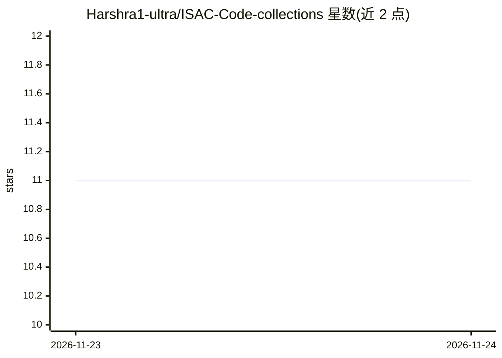

# Harshra1-ultra/ISAC-Code-collections

⭐ 11 · MIT · 推送 2026-11-19 · [GitHub](https://github.com/Harshra1-ultra/ISAC-Code-collections) · [官网](https://harshra1-ultra.github.io/harsh/isac-literature-code-collection.html) · 个人维护

**为ISAC研究者汇集开源代码、仿真包与数据集的清单**

面向通信感知一体化（ISAC）研究的论文/项目代码聚合清单，收录 65 篇论文或项目的公开代码、仿真包、数据集与可复现实现，覆盖 MATLAB 与 Python 两种环境，主题包括联合通感波束赋形、波形设计、MIMO-ISAC、RIS/IRS 辅助 ISAC、近场 ISAC、多用户 ISAC、参数估计、资源分配及学习类方法。表格条目记录论文标题、作者、发表渠道、年份、代码语言、仓库链接与 DOI；强调使用者应引用原始论文。无统一安装方式，各代码依赖其原始仓库。

## 筛选速览

| 维度 | 判定 | 备注 |
|---|---|---|
| AI 角色 | `ai-knowledge` | 知识聚合/清单类 |
| 许可风险 | `permissive` | MIT |
| 部署形态 | `None` |  |
| 模型依赖 | — | README 未给出锁定关系 |
| 硬件要求 | — | 无带数字的原话,不猜 |
| 安装摩擦 | `low` | 无编译、无系统依赖或容器化 |
| 成熟度 | — | 结构信号不足 |

## 能力要点

- 按论文组织 65 条条目，含代码仓库与 DOI 链接字段
- 覆盖 MATLAB 与 Python 双环境的 ISAC 实现
- 主题跨度：波束赋形、波形设计、近场 ISAC、RIS 辅助、学习类方法
- 声明引用规范：须引用原始论文而非本清单

## 适用场景

- 查找某篇 ISAC 论文对应的开源实现
- 为 6G/ISAC 研究复现基线算法
- 按主题筛选波束赋形或波形设计的参考代码

## 场景标签

`精选清单` `科研工具` · 领域:学习与行业

## 证据(README 行号)

> L1: # ISAC-Codes-Collection: A Collection of Codes for ISAC Research (in both MATLAB and python environments)
> L3: This repository is a collection of publicly available **codes, simulation packages, datasets, and reproducible imple
> L60: |No.|Paper Title|Authors|Year|Venue|Topic|Code|

## 星数曲线

2026-11-23 11 → 2026-11-24 11（+0）

---
*卡片 v1 · prompt 1.4 · 生成 2026-11-23 · 置信度 high · 依据 README sha `f2731f40dbfb` · [字段定义](../../DATASET.md)*
