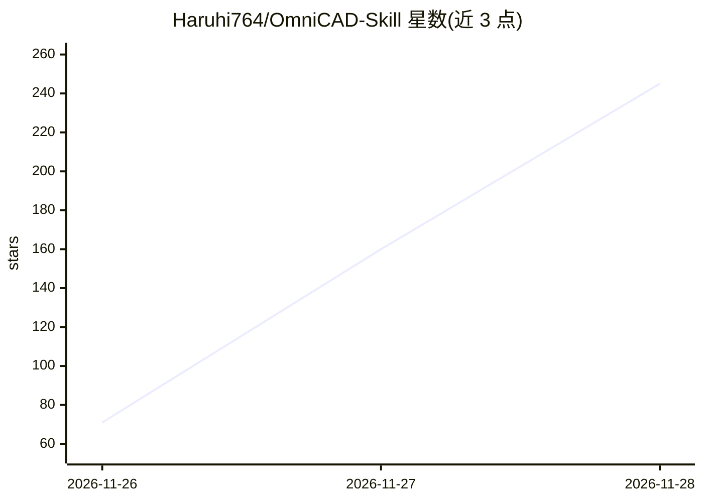

# Haruhi764/OmniCAD-Skill

⭐ 245 · Python · MIT · 推送 2026-11-27 · [GitHub](https://github.com/Haruhi764/OmniCAD-Skill) · 个人维护 · 中文 README

**给 Codex 用户的 AI CAD 自动绘图 Skill，生成可编辑 DXF 并做证据驱动验收**

为 Codex 开发的 Agent Skill，提供可编辑二维 DXF 自动制图、限定范围的图纸局部修改与差异检查，以及证据驱动的工程验收（OQA）：将实测几何与已确认的工程要求比对，输出成果哈希、视觉证据与未解决要求清单。纯 Python DXF 流程不依赖 AutoCAD；Windows 完整版 AutoCAD 2023 可用于原生 DWG 保存与 PDF 出图。覆盖建筑、土木、机械二维制图，含 43 项离线测试与五类专业图纸验收。自动检查不替代人工专业复核，macOS 原生路径不支持。

## 筛选速览

| 维度 | 判定 | 备注 |
|---|---|---|
| AI 角色 | `ai-native` | 本体是模型或模型工具 |
| 许可风险 | `permissive` | MIT |
| 部署形态 | `None` |  |
| 模型依赖 | — | README 未给出锁定关系 |
| 硬件要求 | — | 无带数字的原话,不猜 |
| 安装摩擦 | `low` | 无编译、无系统依赖或容器化 |
| 成熟度 | — | 结构信号不足 |

## 能力要点

- 证据驱动 OQA 验收：几何实测比对、成果哈希绑定与复核证据
- 纯 Python DXF 工作流不依赖 AutoCAD；Windows AutoCAD 2023 原生 DWG/PDF 出图
- DXF 局部修改、同源图纸差异检查与逐页打印对照
- 机械·土木·建筑·食品工艺·车间布置五类专业验收

## 适用场景

- 用 Codex 自动生成建筑、土木或机械二维工程图并验收
- 对已有 DXF 图纸做限定范围的局部修改与差异检查
- 对自动出图做尺寸实测与可追溯交付记录

## 场景标签

 · 领域:工程/工业设计工具

## 证据(README 行号)

> L15: OmniCAD 是我为 Codex 开发的开源 AI CAD 自动绘图 Skill，结合可编辑二维 DXF 制图、限定范围的图纸修改和证据驱动工程验收（OQA）。纯 Python DXF 工作流不依赖 AutoCAD；Window
> L43: 图纸看起来正确，尺寸却可能存在错误。OmniCAD 将经过确认的工程要求与实际测量结果进行比对，而不是依赖图纸的外观或 AI 的自我评价。

## 星数曲线

2026-11-26 71 → 2026-11-28 245（+174）

---
*卡片 v1 · prompt 1.4 · 生成 2026-11-28 · 置信度 high · 依据 README sha `f9d2c1d2d928` · [字段定义](../../DATASET.md)*
