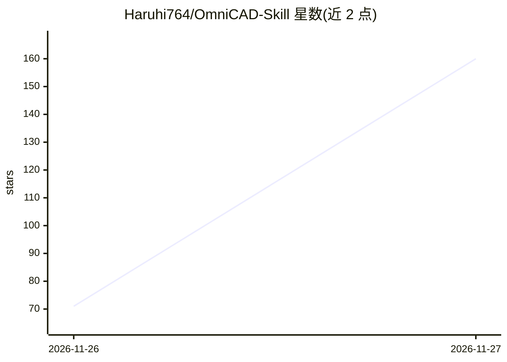

# Haruhi764/OmniCAD-Skill

⭐ 160 · Python · MIT · 推送 2026-11-26 · [GitHub](https://github.com/Haruhi764/OmniCAD-Skill) · 个人维护 · 中文 README

**为 Codex 提供的可编辑 2D CAD 自动绘图与验收 Skill**

以 Codex Skill 形式发布的 CAD 自动绘图工具：根据明确尺寸与绘图要求生成可编辑 DXF，在 Windows 已授权 AutoCAD 环境下输出 DWG 与 PDF。覆盖建筑、土木、机械二维制图（轴网、墙线、门窗、阶梯轴、法兰、剖面等），提供 DXF 局部修改、差异检查与 OQA 五类专业图纸验收；验收含人工复核项，publish 为视觉证据保留待复核状态。基础包仅支持纯 DXF，PDF/DWG 需附加依赖与环境。

## 筛选速览

| 维度 | 判定 | 备注 |
|---|---|---|
| AI 角色 | `ai-native` | 本体是模型或模型工具 |
| 许可风险 | `permissive` | MIT |
| 部署形态 | `None` |  |
| 模型依赖 | — | README 未给出锁定关系 |
| 硬件要求 | — | 无带数字的原话,不猜 |
| 安装摩擦 | `low` | 无编译、无系统依赖或容器化 |
| 成熟度 | — | 结构信号不足 |

## 能力要点

- 生成可编辑 DXF 并支持局部修改与差异检查
- Windows AutoCAD 原生 DWG 保存与 PDF 出图
- 五类专业图纸验收（OQA）与逐页打印对照
- 提供含 wheel 的 Release ZIP 与 CLI/Codex Skill 分离安装

## 适用场景

- 建筑与土木二维施工图的自动绘制
- 机械零件（阶梯轴、法兰）工程图生成
- 对已有 DXF 图纸做局部修改与差异检查
- 生成图纸的验收与人工复核流程管理

## 场景标签

`代码生成` · 领域:编码与开发

## 证据(README 行号)

> L15: OmniCAD 是我为 Codex 开发的开源 CAD 自动绘图 Skill。它可以根据明确的尺寸和绘图要求生成可编辑 DXF，并在支持的 AutoCAD 环境中输出 DWG 和 PDF。
> L42: - DXF 局部修改、差异检查与 OQA 验收。

## 星数曲线

2026-11-26 71 → 2026-11-27 160（+89）

---
*卡片 v1 · prompt 1.4 · 生成 2026-11-27 · 置信度 high · 依据 README sha `6416efa727fb` · [字段定义](../../DATASET.md)*
