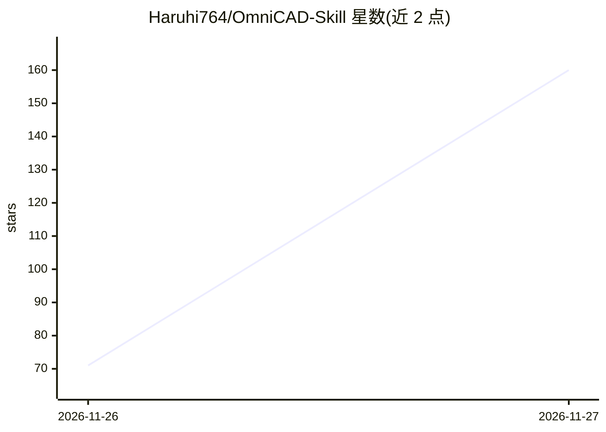

# Haruhi764/OmniCAD-Skill

⭐ 160 · Python · MIT · 推送 2026-11-26 · [GitHub](https://github.com/Haruhi764/OmniCAD-Skill) · 个人维护 · 中文 README

**让 Codex 代理生成可编辑 DXF 工程图并做证据验收的 Skill**

面向 Codex 代理的开源 CAD 自动绘图 Skill：依据明确尺寸与制图要求生成可编辑 DXF，在已授权的 Windows AutoCAD 环境中保存原生 DWG 并出 PDF；覆盖建筑、土木的轴网/墙线/门窗/标注，机械的阶梯轴、法兰、剖面、键槽与公差标注；带 DXF 局部修改、差异检查与 OQA 证据验收流程，验收含人工复核项。纯 DXF 仅需 Python 3.10+ 基础包；PDF/图片预检需 intake 附加依赖与 Poppler；DWG/PDF 依赖 Windows 与已授权 AutoCAD。

## 筛选速览

| 维度 | 判定 | 备注 |
|---|---|---|
| AI 角色 | `ai-native` | 本体是模型或模型工具 |
| 许可风险 | `permissive` | MIT |
| 部署形态 | `library` | 以包/库形式分发 |
| 模型依赖 | — | README 未给出锁定关系 |
| 硬件要求 | — | 无带数字的原话,不猜 |
| 安装摩擦 | `low` | 无编译、无系统依赖或容器化 |
| 成熟度 | — | 结构信号不足 |

## 能力要点

- 按尺寸要求生成可编辑 DXF，支持局部修改与差异检查
- OQA 证据验收流程，缺失视觉证据保留待复核状态
- Windows AutoCAD 原生 DWG 保存与 PDF 出图
- CLI 与 Codex Skill 两种使用方式可分开运行

## 适用场景

- 让 AI 代理按参数复现阶梯轴、法兰等机械工程图
- 批量生成建筑与土木二维图纸并自动验收
- 对已有 DXF 做局部修改与差异检查

## 场景标签

`代码生成` · 领域:编码与开发

## 证据(README 行号)

> L15: OmniCAD 是我为 Codex 开发的开源 CAD 自动绘图 Skill。它可以根据明确的尺寸和绘图要求生成可编辑 DXF，并在支持的 AutoCAD 环境中输出 DWG 和 PDF。
> L40: - DXF 局部修改、差异检查与 OQA 验收。

## 星数曲线

2026-11-26 71 → 2026-11-27 160（+89）

---
*卡片 v1 · prompt 1.4 · 生成 2026-11-26 · 置信度 high · 依据 README sha `fe1ba88c998b` · [字段定义](../../DATASET.md)*
