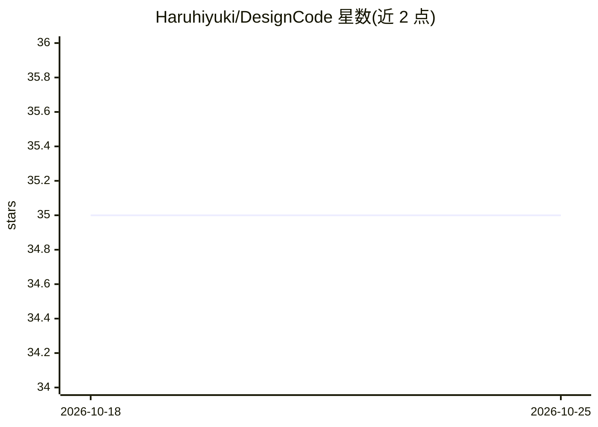

# Haruhiyuki/DesignCode

⭐ 35 · JavaScript · Apache-2.0 · 推送 2026-06-28 · [GitHub](https://github.com/Haruhiyuki/DesignCode) · [官网](http://designcode.cc/) · 组织维护 · 中文 README

**Agent 驱动的平面设计工作台，对话生成可编辑设计稿**

基于 Tauri/Vue 的桌面设计工作台（macOS/Windows）：用户在聊天面板用自然语言描述需求，Agent 生成设计稿并支持多轮对话迭代。以 HTML/CSS/SVG 为设计媒介，提供矢量级 PNG/SVG/PDF 导出、带 alpha 通道的多层 PSD 导出、实时画布预览与直接文本编辑、素材库、风格预设和版本历史。需 Agent 后端运行，内置 Codex 与 OpenCode，Claude Code 需另行安装。

## 筛选速览

| 维度 | 判定 | 备注 |
|---|---|---|
| AI 角色 | `ai-native` | 本体是模型或模型工具 |
| 许可风险 | `permissive` | Apache-2.0 |
| 部署形态 | `None` |  |
| 模型依赖 | — | README 未给出锁定关系 |
| 硬件要求 | — | 无带数字的原话,不猜 |
| 安装摩擦 | `low` | 无编译、无系统依赖或容器化 |
| 成熟度 | — | 结构信号不足 |

## 能力要点

- 对话式生成设计稿，多轮迭代与可追溯版本历史
- 矢量级 PNG/SVG/PDF 导出与多层 PSD 导出（含 alpha 通道）
- 以 HTML/CSS/SVG 为设计媒介，画布直接编辑文本
- 支持 Codex、Claude Code、OpenCode 三种 Agent 后端

## 适用场景

- 通过对话快速生成海报、书封、产品详情页等设计稿
- 导出可继续编辑的矢量文件或多层 PSD 交付设计流程
- 预设尺寸与风格批量产出含文字排版的平面设计

## 场景标签

`图像生成` · 领域:内容生成

## 证据(README 行号)

> L16: DesignCode is an agent-based graphic design workbench that transforms simple instructions into high-quality design 
> L22: 1. Describe your requirements directly to the Agent in the chat panel, receive a complete design draft, and iterate

## 星数曲线

2026-10-18 35 → 2026-10-25 35（+0）

---
*卡片 v1 · prompt 1.4 · 生成 2026-10-25 · 置信度 high · 依据 README sha `c40bcc9e7668` · [字段定义](../../DATASET.md)*
