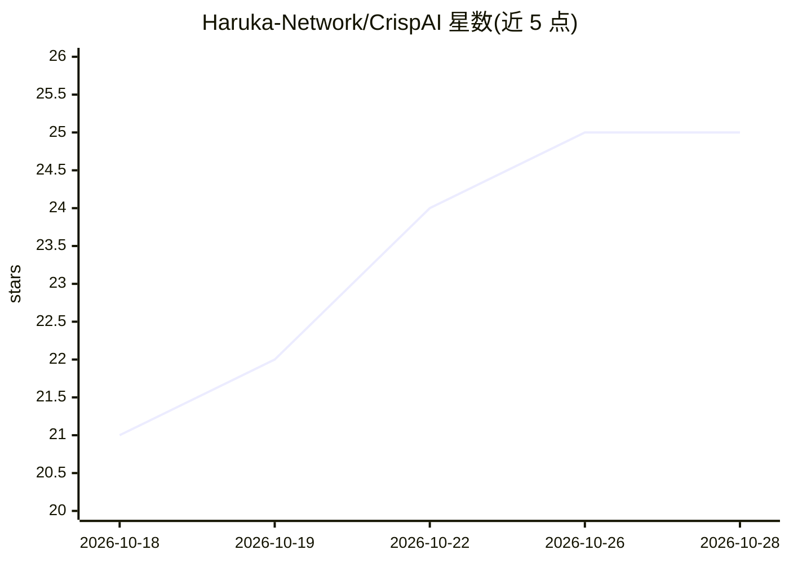

# Haruka-Network/CrispAI

⭐ 25 · TypeScript · AGPL-3.0 · 推送 2026-09-20 · [GitHub](https://github.com/Haruka-Network/CrispAI) · [官网](https://ai.haruka.cloud/) · 组织维护 · 中文 README

**Crisp 客服助手的自部署版：自动回复+AI 知识库+Telegram 同步**

面向 Crisp 在线客服用户的自部署服务，由 Bun + Hono 应用、pgvector PostgreSQL 与 Redis 三个容器组成，docker compose 一键启动。功能包括关键词自动回复、带知识库向量检索的 AI 回复、选项卡片、欢迎语脚本，并可将每个 Crisp 会话同步到 Telegram 话题群供客服直接回复；支持单用户多项目管理。部署需要公网 https 域名、自建 Crisp 私有插件与 Telegram 机器人。后端源码以 AGPL-3.0 授权。

## 筛选速览

| 维度 | 判定 | 备注 |
|---|---|---|
| AI 角色 | `ai-native` | 本体是模型或模型工具 |
| 许可风险 | `viral` | AGPL-3.0 |
| 部署形态 | `self-host` | docker 或自建部署 |
| 模型依赖 | — | README 未给出锁定关系 |
| 硬件要求 | — | 无带数字的原话,不猜 |
| 安装摩擦 | `low` | 无编译、无系统依赖或容器化 |
| 成熟度 | — | 结构信号不足 |

## 能力要点

- 关键词自动回复与选项卡片、欢迎语
- AI 回复基于 pgvector 知识库向量检索
- Crisp 会话同步到 Telegram 话题群，客服在 Telegram 内直接回复
- docker compose 一键起 app/postgres/redis 全套

## 适用场景

- 我想自部署一个 Crisp 客服自动回复与 AI 知识库问答服务
- 客服团队希望在 Telegram 里接收并回复网站访客消息
- 多个 Crisp 站点需要在同一后台统一配置自动回复规则

## 场景标签

`聊天机器人` `文档问答` · 领域:对话与助手

## 证据(README 行号)

> L3: Crisp 智能客服助手的自部署版：关键词自动回复、AI 回复（带知识库检索）、选项卡片、欢迎语，
> L11: |`postgres`|`pgvector/pgvector`，知识库检索用 vector 扩展|

## 星数曲线

2026-10-18 21 → 2026-10-28 25（+4）

---
*卡片 v1 · prompt 1.4 · 生成 2026-10-27 · 置信度 high · 依据 README sha `0ec82973a4ad` · [字段定义](../../DATASET.md)*
