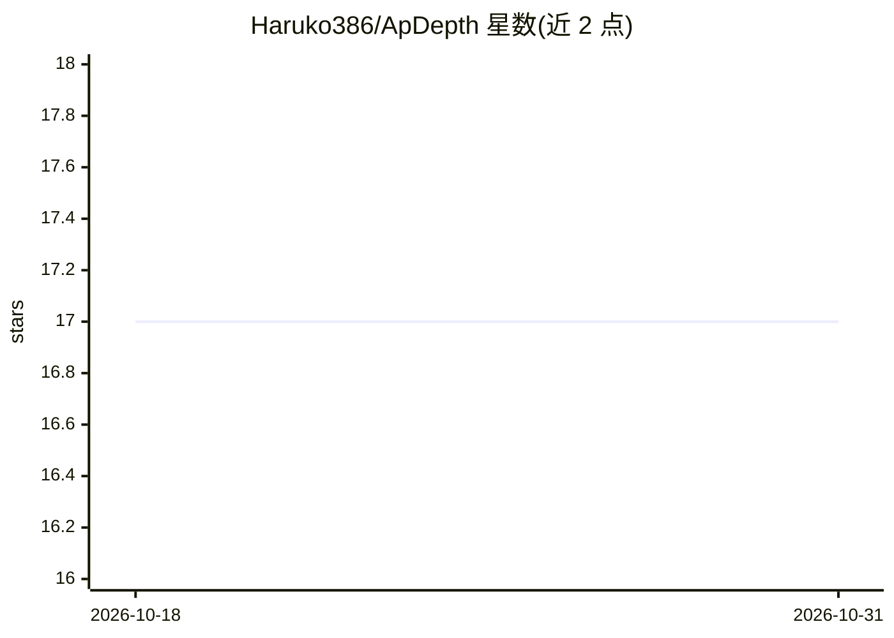

# Haruko386/ApDepth

⭐ 17 · Python · Apache-2.0 · 推送 2026-10-26 · [GitHub](https://github.com/Haruko386/ApDepth) · [官网](https://haruko386.github.io/research/) · 个人维护

**基于扩散模型的单目深度估计框架，确定性单步推理**

ApDepth 是基于 Marigold（Stable Diffusion）的单目深度估计框架，将随机多步生成改为确定性单步感知，在 Hypersim 与 Virtual KITTI 合成数据上微调，训练时利用 Depth-Anything-V2 ViT-G 生成深度先验。训练流程为阶段一特征对齐（独立仓库）、阶段二主训练（含 FFT 损失精修）与可选的 VKITTI 远景后训练。本仓库提供阶段二训练、推理与评测代码；提供 Docker 环境，推理在 Ubuntu 22.04 + CUDA 11.8 + RTX 4090 上测试，支持 Apple Silicon MPS 加速与 fp16。

## 筛选速览

| 维度 | 判定 | 备注 |
|---|---|---|
| AI 角色 | `ai-native` | 本体是模型或模型工具 |
| 许可风险 | `permissive` | Apache-2.0 |
| 部署形态 | `self-host` | docker 或自建部署 |
| 模型依赖 | — | README 未给出锁定关系 |
| 硬件要求 | — | 无带数字的原话,不猜 |
| 安装摩擦 | `low` | 无编译、无系统依赖或容器化 |
| 成熟度 | — | 结构信号不足 |

## 能力要点

- 确定性单步扩散推理，替代 Marigold 的多步生成
- 两阶段训练策略：MSE 基础训练 + FFT 边缘结构学习
- 可选 VKITTI 远景深度后训练（6000 步独立流程）
- 提供 Docker 镜像与多数据集评测脚本

## 适用场景

- 对单张 RGB 图像生成深度预测图
- 在 NYU 等公开基准上复现论文评测结果
- 基于合成数据微调自己的深度估计模型

## 场景标签

`微调` `图像视频处理` · 领域:感知与多模态

## 证据(README 行号)

> L12: > We present **ApDepth**, a deterministic single-step diffusion framework for monocular depth estimation. Built upo
> L113: python run.py \

## 星数曲线

2026-10-18 17 → 2026-10-31 17（+0）

---
*卡片 v1 · prompt 1.4 · 生成 2026-10-30 · 置信度 mid · 依据 README sha `e5130c91bfe4` · [字段定义](../../DATASET.md)*
