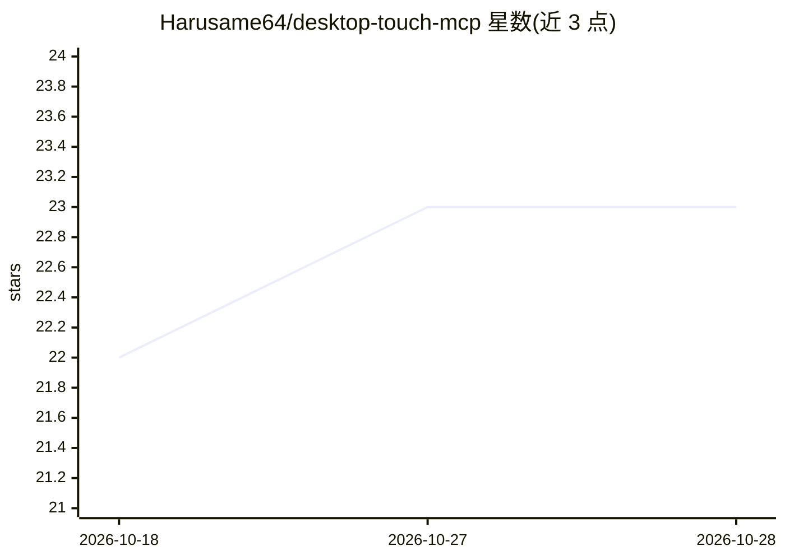

# Harusame64/desktop-touch-mcp

⭐ 24 · TypeScript · MIT · 推送 2026-10-28 · [GitHub](https://github.com/Harusame64/desktop-touch-mcp) · [官网](https://harusame64.github.io/desktop-touch-mcp/) · 个人维护

**Windows 桌面 computer-use MCP server，供 Claude 等 MCP 客户端操作本机应用**

面向 Windows 10/11 的 Model Context Protocol 服务器：让 Claude、Cursor、VS Code Copilot 等 MCP 客户端通过截图、UI Automation、Chrome CDP、键鼠与终端操控本机桌面应用。核心机制是语义化 discover-then-act（desktop_discover 返回实体与短期租约而非像素坐标）与逐动作感知防护（输入前校验目标窗口身份与边界）；UIA 由 Rust 原生引擎承担，不可用时回退 PowerShell，UIA 不可见的界面用 Windows OCR 加 Set-of-Mark 标注。另含 Key Locker 凭据加密存储与 ssh/sudo 密码自动填充、3 档 token 消减模式与左上角紧急停止。macOS Apple Silicon 仅限 4 个工具的预览。

## 筛选速览

| 维度 | 判定 | 备注 |
|---|---|---|
| AI 角色 | `ai-ecosystem` | LLM/agent 周边工具 |
| 许可风险 | `permissive` | MIT |
| 部署形态 | `desktop` | 安装包/桌面程序 |
| 模型依赖 | — | README 未给出锁定关系 |
| 硬件要求 | — | 无带数字的原话,不猜 |
| 安装摩擦 | `low` | 无编译、无系统依赖或容器化 |
| 成熟度 | — | 结构信号不足 |

## 能力要点

- desktop_discover/desktop_act 语义实体+租约定位，避开像素坐标
- 逐动作感知防护拦截打错窗口与过期坐标点击
- Rust 原生 UIA 引擎，缺失时透明回退 PowerShell，OCR+SoM 兜底无障碍树应用
- Key Locker 以 DPAPI 加密存储凭据，终端自动填充 ssh/sudo 密码

## 适用场景

- 让 Claude/Cherry Studio 等 MCP 客户端替我操作 Excel、Chrome、记事本等桌面应用
- 自动化没有 API、只能靠界面的 Windows 软件流程
- 在终端安全地自动填写 SSH/sudo 密码并逐次确认

## 场景标签

`GUI 自动化` `浏览器自动化` · 领域:效率与自动化

## 证据(README 行号)

> L7: > **Computer-use MCP server for Windows.** Lets Claude, Cursor, or any MCP client see and operate your Windows 10/11
> L15: > **Why this over pixel-clicking?** Two ideas run through every tool: **discover-then-act** — `desktop_discover` re

## 星数曲线

2026-10-18 22 → 2026-10-28 23（+1）

---
*卡片 v1 · prompt 1.4 · 生成 2026-10-27 · 置信度 high · 依据 README sha `0af30c8991fe` · [字段定义](../../DATASET.md)*
