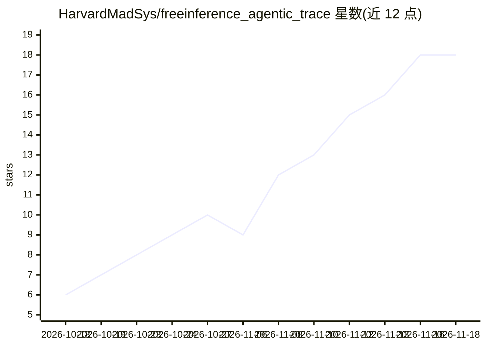

# HarvardMadSys/freeinference_agentic_trace

⭐ 18 · Python · 推送 2026-11-05 · [GitHub](https://github.com/HarvardMadSys/freeinference_agentic_trace) · [官网](https://agent-traces.freeinference.org/) · 组织维护

**人类驱动 Agent 工作负载的大规模追踪数据集与论文复现工件**

论文《From Requests to Sessions》的数据集与复现仓库：采集 16 周 FreeInference 平台上 12,002 个编码/助手 agent 会话（267 个账户、209B 输入 token、118 万次 LLM 请求、121 万次工具调用），记录请求时序与延迟、模型与匿名化 provider、token 用量、工具调用及块级前缀哈希（可重放 KV-cache 复用）；不发布任何消息/提示词/工具结果文本。数据托管于 Hugging Face，提供原始 JSONL（约 108GB）与 Parquet 表（约 9GB）两种表示，含前缀缓存模拟代码与论文图表复现流程。面向系统与 LLM 服务方向的研究者。

## 筛选速览

| 维度 | 判定 | 备注 |
|---|---|---|
| AI 角色 | `ai-knowledge` | 知识聚合/清单类 |
| 许可风险 | `none` | — |
| 部署形态 | `None` |  |
| 模型依赖 | — | README 未给出锁定关系 |
| 硬件要求 | — | 无带数字的原话,不猜 |
| 安装摩擦 | `low` | 无编译、无系统依赖或容器化 |
| 成熟度 | — | 结构信号不足 |

## 能力要点

- 12,002 个 agent 会话 / 209B 输入 token / 1.2M 请求的追踪数据
- 块级前缀哈希支持 KV-cache 复用重放与前缀缓存模拟
- 提供 Raw JSONL（约 108GB）与 Parquet 表（约 9GB）两种数据表示
- make 流水线复现论文图表与缓存模拟

## 适用场景

- 研究 agent 工作负载的会话级特征以指导服务系统设计
- 重放/评估 LLM 服务的前缀缓存与成本策略
- 复现论文中的分析图表与模拟结果

## 场景标签

 · 领域:系统研究/LLM 工作负载分析

## 证据(README 行号)

> L15: This repository contains the dataset and reproducibility artifacts for
> L31: The dataset is hosted on Hugging Face:

## 星数曲线

2026-10-18 6 → 2026-11-18 18（+12）

---
*卡片 v1 · prompt 1.4 · 生成 2026-11-18 · 置信度 high · 依据 README sha `21fad7960ead` · [字段定义](../../DATASET.md)*
