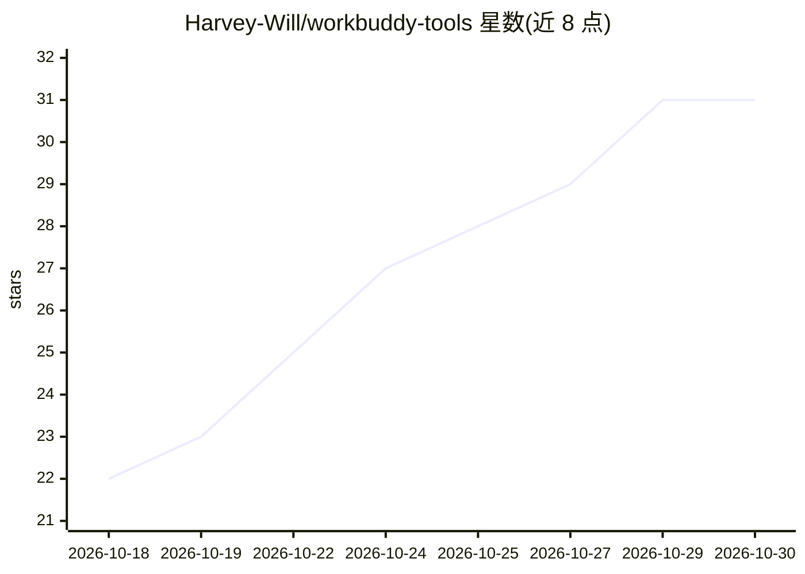

# Harvey-Will/workbuddy-tools

⭐ 31 · Python · MIT · 推送 2026-10-17 · [GitHub](https://github.com/Harvey-Will/workbuddy-tools) · 个人维护 · 中文 README

**WorkBuddy 多账号本地管理工具：账号切换、数据迁移与 Token 统计**

面向 WorkBuddy / WorkBuddyAI 用户的本地账号与数据管理桌面应用：自动识别本机数据，统一展示不同版本与账号，支持一键切换账号、备注管理；在账号或版本间按需迁移聊天会话、Memory、Skills、MCP 配置、Token 记录等数据，迁移前可预览并自动本地备份（同版本账号间会话类数据暂不支持迁移）；另从本地会话数据统计各模型 Token 用量。数据全部本机处理，无云端服务。Windows/macOS 提供便携版下载，内置运行时。

## 筛选速览

| 维度 | 判定 | 备注 |
|---|---|---|
| AI 角色 | `ai-ecosystem` | LLM/agent 周边工具 |
| 许可风险 | `permissive` | MIT |
| 部署形态 | `desktop` | 安装包/桌面程序 |
| 模型依赖 | — | README 未给出锁定关系 |
| 硬件要求 | — | 无带数字的原话,不猜 |
| 安装摩擦 | `low` | 无编译、无系统依赖或容器化 |
| 成熟度 | — | 结构信号不足 |

## 能力要点

- 多账号统一展示与一键切换
- 跨账号/跨版本选择性数据迁移，迁移前预览并自动备份
- 从本地会话数据统计 Token 用量（按模型与时间范围）
- 本地优先：无账号注册、无云端存储，macOS 版未经 Apple 公证

## 适用场景

- 在国内版与国际版 WorkBuddy 账号之间快速切换
- 换账号或换版本时把 Memory、Skills、MCP 配置等带走
- 查看本机各模型的 Token 用量分布

## 场景标签

 · 领域:AI 工具/桌面应用

## 证据(README 行号)

> L13: WorkBuddy Tools 是一款面向 **WorkBuddy / WorkBuddyAI** 的本地账号与数据管理工具。
> L19: **功能**：多账号管理 · 快速切换 · 数据迁移 · 会话与记忆 · Skills / MCP · Token 用量统计 · 本地优先

## 星数曲线

2026-10-18 22 → 2026-10-30 31（+9）

---
*卡片 v1 · prompt 1.4 · 生成 2026-10-26 · 置信度 low · 依据 README sha `7bb92667419f` · [字段定义](../../DATASET.md)*
