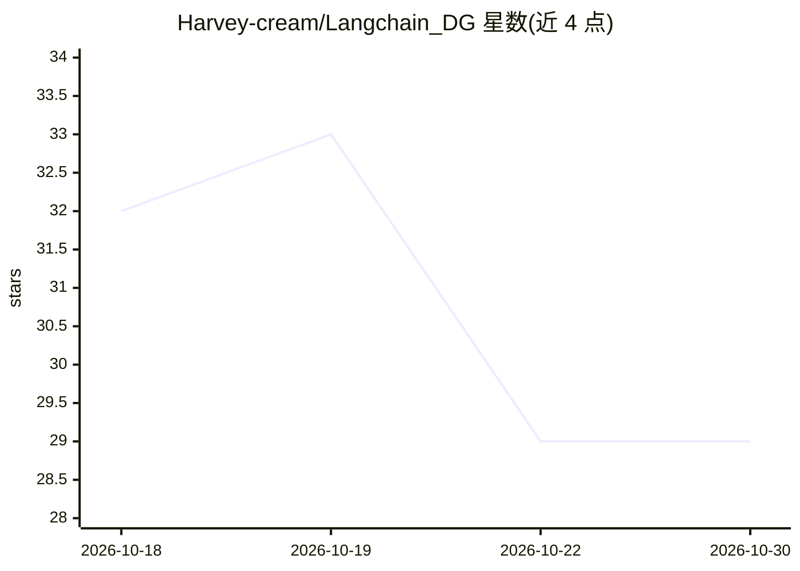

# Harvey-cream/Langchain_DG

⭐ 29 · Python · 推送 2026-10-12 · [GitHub](https://github.com/Harvey-cream/Langchain_DG) · [官网](http://38.190.206.248/login) · 个人维护 · 中文 README

**面向企业合同全生命周期的 AI Agent 平台**

以合同业务闭环为主线的 Web 平台：上传 PDF/Markdown → 文档结构化（ContractClause 抽取、pgvector 入库）→ 基于 LangGraph 的风险审查（Policy + 私有 RAG 上下文）→ 人工 Accept/Reject/Edit 确认 → 新版本生成、Diff 与谈判辅助。设计上采用 Workflow First：CRUD、Diff、解析、导出等确定性逻辑用 Python 模块，仅审查/修订/谈判节点用 Agent；业务状态存 PostgreSQL，Agent 运行时状态存 LangGraph Checkpoint。README 明确当前已实现至 P4 + Review Graph 优化，Revision/人工批准/Diff/谈判/交付的完整生命周期描述属目标规划而非已交付功能。技术栈为 FastAPI + React + PostgreSQL/pgvector + DashScope。

## 筛选速览

| 维度 | 判定 | 备注 |
|---|---|---|
| AI 角色 | `ai-native` | 本体是模型或模型工具 |
| 许可风险 | `none` | — |
| 部署形态 | `self-host` | docker 或自建部署 |
| 模型依赖 | — | README 未给出锁定关系 |
| 硬件要求 | — | 无带数字的原话,不猜 |
| 安装摩擦 | `low` | 无编译、无系统依赖或容器化 |
| 成熟度 | `idea` | |

## 能力要点

- LangGraph 审查工作流：Policy + 私有 RAG 上下文 + Pydantic 结构化输出 RiskFinding
- Human-in-the-loop：AI 建议需人工 Accept/Reject/Edit 后才生成新 ContractVersion
- append-only 版本模型：V1/V2/V3 完整快照，版本号单调递增，按 user_id 隔离
- 业务状态（PostgreSQL）与 Agent 运行时状态（LangGraph Checkpoint）分离

## 适用场景

- 上传合同 PDF 后自动抽取条款并输出结构化风险点
- 按企业政策与历史合同审查条款风险，人工确认后再生成新版本
- 对比合同新旧版本的结构化变更并辅助谈判
- 维护多客户多版本的合同档案与审计追踪

## 场景标签

`文档解析` `文档问答` · 领域:知识与检索

## 证据(README 行号)

> L9: LangChain DG 是一个**企业合同全生命周期 AI Agent 平台**。系统围绕合同的完整业务闭环构建：合同上传 → 文档结构化 → 风险审查 → 人工确认 → 新版本生成 → 客户回传 Diff → 谈判辅助 → 合同
> L35: - **Review Workflow**：面向合同条款的审查工作流
> L42: - AI 不直接覆盖合同，风险点先转为 **Revision Proposal**

## 星数曲线

2026-10-18 32 → 2026-10-30 29（-3）

---
*卡片 v1 · prompt 1.4 · 生成 2026-10-26 · 置信度 mid · 依据 README sha `649fba6ddc81` · [字段定义](../../DATASET.md)*
