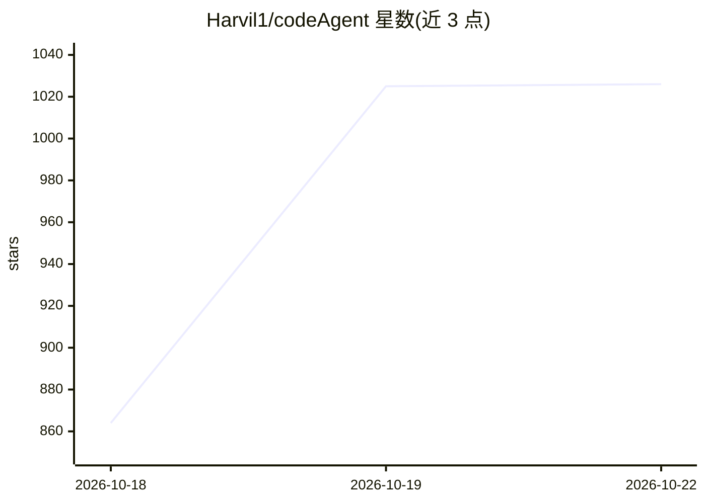

# Harvil1/codeAgent

⭐ 1,026 · Python · MIT · 推送 2026-10-14 · [GitHub](https://github.com/Harvil1/codeAgent) · 个人维护 · 中文 README

**终端里的中文自学习 AI 编程助手，读码改文件跑命令**

Python 3.11+ 的终端 AI 编程代理：接收自然语言指令后读取仓库、规划多步改动、编辑文件、执行命令与测试并迭代直至完成。支持 OpenAI 兼容协议（默认 DeepSeek）与 Anthropic 协议多模型接入，主辅模型分工。机制上包含工具自注册、MCP 外部工具、分级上下文压缩、长期记忆与从对话轨迹沉淀技能的自学习管线、子代理/团队模式、工作流引擎，以及命令审批、注入检测、秘钥扫描等安全防线。Windows 优先开发验证，Linux 可运行（含 bwrap 沙箱），macOS 未充分验证。通过 uv 安装运行。

## 筛选速览

| 维度 | 判定 | 备注 |
|---|---|---|
| AI 角色 | `ai-native` | 本体是模型或模型工具 |
| 许可风险 | `permissive` | MIT |
| 部署形态 | `None` |  |
| 模型依赖 | — | README 未给出锁定关系 |
| 硬件要求 | — | 无带数字的原话,不猜 |
| 安装摩擦 | `low` | 无编译、无系统依赖或容器化 |
| 成熟度 | — | 结构信号不足 |

## 能力要点

- 工具自注册体系与 MCP 外部工具接入（.mcp.json）
- 自学习管线：从对话轨迹沉淀可复用技能
- 分级上下文压缩（L1 轻裁剪→L4 深度摘要）与前缀缓存友好设计
- 破坏性命令审批、注入面检测、秘钥扫描、SSRF 防护等安全防线

## 适用场景

- 在终端用自然语言让 AI 读代码、改文件、跑测试完成编程任务
- 学习 Agent 全链路开发（工具注册、上下文压缩、子代理等中文注释实现）
- 通过长期记忆与技能系统沉淀个人使用习惯

## 场景标签

`编码 Agent` · 领域:编码与开发

## 证据(README 行号)

> L11: CodeAgent 是一个跑在终端里的 AI 编程助手：你用自然语言下指令，它读代码、改文件、跑命令、查资料，把活干完。它有自己的一套「长本事」机制——从对话轨迹里沉淀可复用的技能，越用越顺手。
> L30: - 多模型接入：OpenAI 兼容协议（默认 DeepSeek）与 Anthropic 协议均可配；主模型 + 辅助小模型（压缩/检索/记忆提取等杂活走便宜模型）
> L105: 调用链一句话：`main.py`（点火：控制台编码、终端自举）→ `cli.main` → `run_interactive`（REPL + slash 命令 + RuntimeContext 装配）→ `AIAgent.run

## 星数曲线

2026-10-18 864 → 2026-10-22 1,026（+162）

---
*卡片 v1 · prompt 1.4 · 生成 2026-10-21 · 置信度 high · 依据 README sha `504e5e1c62c2` · [字段定义](../../DATASET.md)*
