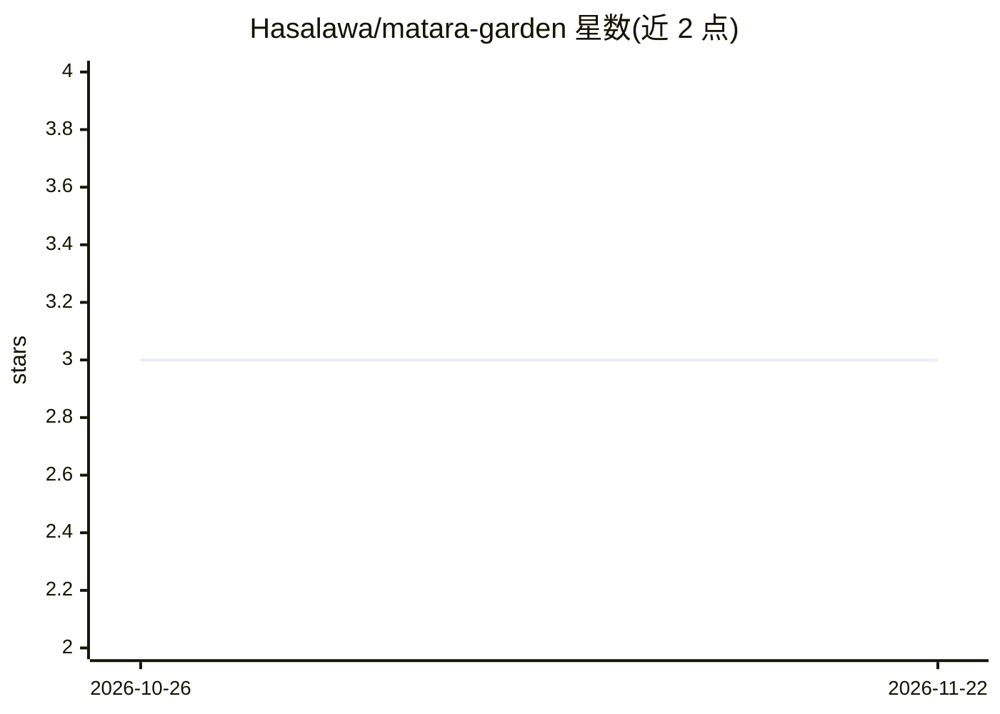

# Hasalawa/matara-garden

⭐ 3 · Python · MIT · 推送 2026-10-08 · [GitHub](https://github.com/Hasalawa/matara-garden) · 个人维护

**为斯里兰卡马塔拉家庭园丁提供离线每周园艺清单**

面向斯里兰卡马塔拉家庭园丁的每周园艺清单网页应用：基于规则的作物日历给出本周可收获、可播种与需养护的任务清单，可勾选记录并保存到本地 garden.json。本地 Gemma 模型（经 Ollama）生成页面顶部每周短评，支持英语/僧伽罗语切换；Ollama 未运行时清单功能仍可用。仅依赖 Python 标准库，可离线运行，也可在局域网内手机访问。作物数据为初版通用数据，建议按本地情况编辑校准。

## 筛选速览

| 维度 | 判定 | 备注 |
|---|---|---|
| AI 角色 | `ai-enhanced` | 去掉 AI 部分产品仍成立 |
| 许可风险 | `permissive` | MIT |
| 部署形态 | `desktop` | 安装包/桌面程序 |
| 模型依赖 | local-ok | 支持本地模型 |
| 硬件要求 | — | 无带数字的原话,不猜 |
| 安装摩擦 | `low` | 无编译、无系统依赖或容器化 |
| 成熟度 | — | 结构信号不足 |

## 能力要点

- 规则驱动作物日历生成每周收获/播种/养护清单
- 本地 Gemma 经 Ollama 生成每周短评，支持 --model 换模型
- 离线运行，数据保存在本机 garden.json
- 英语/僧伽罗语双语切换

## 适用场景

- 查看本周自家菜园该收获、播种和养护哪些作物
- 信号弱的户外环境下离线使用园艺计划
- 让本地模型生成每周园艺提示短文

## 场景标签

 · 领域:生活工具/园艺

## 证据(README 行号)

> L3: A weekly garden checklist for home gardeners in Matara, Sri Lanka. Open it, see what to harvest, sow and look after 
> L5: It runs on your own laptop, offline. A small rule-based crop calendar decides what needs doing (so dates and crops a
> L15: No packages to install: the app uses only Python's standard library. If Ollama isn't running, the checklist still w

## 星数曲线

2026-10-26 3 → 2026-11-22 3（+0）

---
*卡片 v1 · prompt 1.4 · 生成 2026-11-22 · 置信度 high · 依据 README sha `3328dcc70f8c` · [字段定义](../../DATASET.md)*
