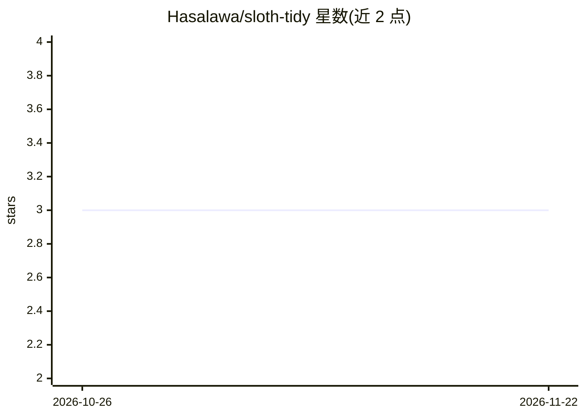

# Hasalawa/sloth-tidy

⭐ 3 · Python · MIT · 推送 2026-10-24 · [GitHub](https://github.com/Hasalawa/sloth-tidy) · 个人维护

**本地 AI 整理混乱文件夹：分类重命名可撤销**

单文件 Python 工具（仅标准库、零依赖），调用 Ollama 中运行的开源权重小模型（默认 llama3.2:3b）读取文件名与文本文件前 600 字符，经 JSON schema 结构化输出返回分类与新文件名，按计划移动文件。默认 dry run、提供按类分组的浏览器审查界面与一键撤销；模型回复被当作不可信输入做校验清洗。另有 CLI 与 watch 后台模式，可切换任意已拉取的 Ollama 模型或用 --no-ai 退化为扩展名规则。需本机装有 Ollama，笔记本 CPU 上约每文件一次模型调用。

## 筛选速览

| 维度 | 判定 | 备注 |
|---|---|---|
| AI 角色 | `ai-native` | 本体是模型或模型工具 |
| 许可风险 | `permissive` | MIT |
| 部署形态 | `None` |  |
| 模型依赖 | local-ok | 支持本地模型 |
| 硬件要求 | — | 无带数字的原话,不猜 |
| 安装摩擦 | `low` | 无编译、无系统依赖或容器化 |
| 成熟度 | `idea` | |

## 能力要点

- 模型输出经 JSON schema（category 枚举 + 新名）结构化约束，名称 slugify 防路径穿越
- 默认 dry run、全程日志、一键 undo 回滚
- 浏览器 GUI / CLI / watch 后台三种运行方式，零依赖单文件
- Ollama 不可用时按扩展名规则优雅降级

## 适用场景

- 整理下载文件夹里堆积的文档、图片、账单
- 在离线环境下完成文件分类且不外传数据
- 用 watch 模式让文件夹在后台持续保持整洁

## 场景标签

 · 领域:文件管理/本地 AI 工具

## 证据(README 行号)

> L12:  A small open-weight model running in Ollama reads each file's name and a short snippet,
> L61: 1. For each file, the name, size and the first 600 characters (text-like files only) go to Ollama's `POST /api/chat
> L74: python3 sloth_tidy.py --no-ai tidy ./messy      # skip the model, extension rules only

## 星数曲线

2026-10-26 3 → 2026-11-22 3（+0）

---
*卡片 v1 · prompt 1.4 · 生成 2026-11-22 · 置信度 high · 依据 README sha `6a10f905b506` · [字段定义](../../DATASET.md)*
