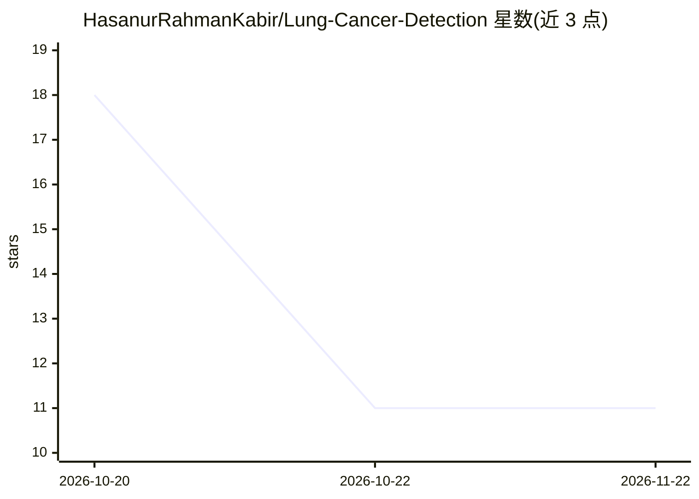

# HasanurRahmanKabir/Lung-Cancer-Detection

⭐ 11 · Jupyter Notebook · 推送 2026-01-24 · [GitHub](https://github.com/HasanurRahmanKabir/Lung-Cancer-Detection) · 个人维护

**基于调查健康数据的肺癌风险机器学习预测研究项目**

README 仅含一行标题，无功能描述、安装步骤或使用说明。根据仓库描述与主题标签，该项目为机器学习研究代码：使用决策树、随机森林与 KNN 三种分类算法，在问卷类健康调查数据上做肺癌风险预测，属于分类研究用途。除此之外 README 未提供任何可验证细节，实际实现、数据来源与运行方式均无法从 README 确认。

## 筛选速览

| 维度 | 判定 | 备注 |
|---|---|---|
| AI 角色 | `ai-native` | 本体是模型或模型工具 |
| 许可风险 | `none` | — |
| 部署形态 | `None` |  |
| 模型依赖 | — | README 未给出锁定关系 |
| 硬件要求 | — | 无带数字的原话,不猜 |
| 安装摩擦 | `low` | 无编译、无系统依赖或容器化 |
| 成熟度 | — | 结构信号不足 |

## 能力要点

- 使用决策树、随机森林、KNN 三种分类算法（来自仓库描述）
- 数据为调查类健康数据
- 面向分类研究场景

## 适用场景

- 复现肺癌风险预测的机器学习实验
- 学习健康调查数据上的分类建模流程

## 场景标签

`科研工具` · 领域:学习与行业

## 证据(README 行号)

> L1: # Lung-Cancer-Detection

## 星数曲线

2026-10-20 18 → 2026-11-22 11（-7）

---
*卡片 v1 · prompt 1.4 · 生成 2026-11-19 · 置信度 low · 依据 README sha `cb64f0b5b375` · [字段定义](../../DATASET.md)*
