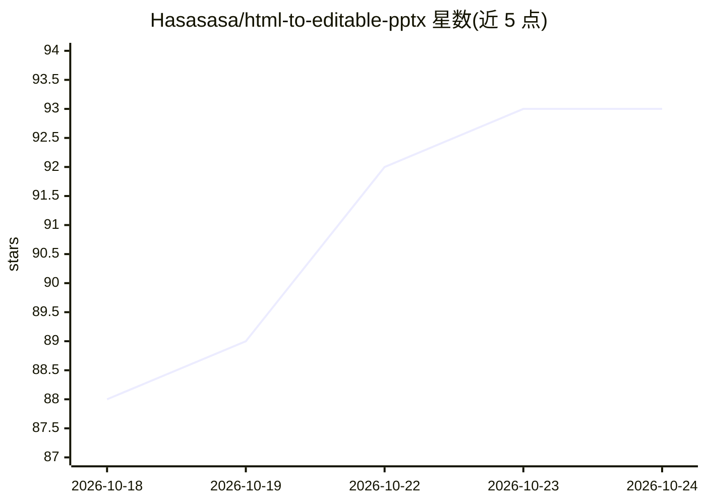

# Hasasasa/html-to-editable-pptx

⭐ 94 · Python · MIT · 推送 2026-07-07 · [GitHub](https://github.com/Hasasasa/html-to-editable-pptx) · 个人维护 · 中文 README

**把 HTML 幻灯片转换为可编辑 .pptx 的工具/Agent 技能**

将单文件 HTML 幻灯片转换为可编辑 .pptx：文本转为原生 PowerPoint 文本框，简单几何转为 OOXML 形状，渐变/阴影/滤镜等复杂效果以本地快照作为底层装饰层；Google Fonts 按实际用字子集嵌入，CJK 内容自动引入 Noto Sans/Serif SC。以 Claude Code 技能形式提供，也可 git clone 后以 Python CLI 直接运行（需 Python 3.10+、Playwright/Chromium）。转换走 preflight→measure→assemble→embed fonts→self check→visual audit 六步流水线，并生成 HTML/PPT 并排审计材料；视觉审计需 Office 或 LibreOffice，但 .pptx 本身生成不依赖渲染器。

## 筛选速览

| 维度 | 判定 | 备注 |
|---|---|---|
| AI 角色 | `ai-ecosystem` | LLM/agent 周边工具 |
| 许可风险 | `permissive` | MIT |
| 部署形态 | `library` | 以包/库形式分发 |
| 模型依赖 | — | README 未给出锁定关系 |
| 硬件要求 | — | 无带数字的原话,不猜 |
| 安装摩擦 | `low` | 无编译、无系统依赖或容器化 |
| 成熟度 | — | 结构信号不足 |

## 能力要点

- 文本保持为可编辑文本框而非整页截图，复杂装饰本地快照化
- 六步流水线：preflight/measure/assemble/embed fonts/self check/visual audit
- Google Fonts 按实际用字子集嵌入，CJK 自动引入 Noto 字体
- 每次安装维护私有的 lessons-learned.md，审计经验累积复用

## 适用场景

- 把 Reveal.js 或手写 HTML 幻灯片交付为可编辑的 .pptx 文件
- 在 Claude Code 中用自然语言触发转换与审计流程
- 需要可搜索、可缩放而非截图式 PPT 的场景

## 场景标签

 · 领域:文档转换/办公工具

## 证据(README 行号)

> L6:  Claude Code skill
> L50: ## Quick start (Claude Code)
> L57: Install this skill for me: https://github.com/Hasasasa/claude-skill-html-to-pptx

## 星数曲线

2026-10-18 88 → 2026-10-24 93（+5）

---
*卡片 v1 · prompt 1.4 · 生成 2026-10-23 · 置信度 mid · 依据 README sha `d7b0fc7c576c` · [字段定义](../../DATASET.md)*
