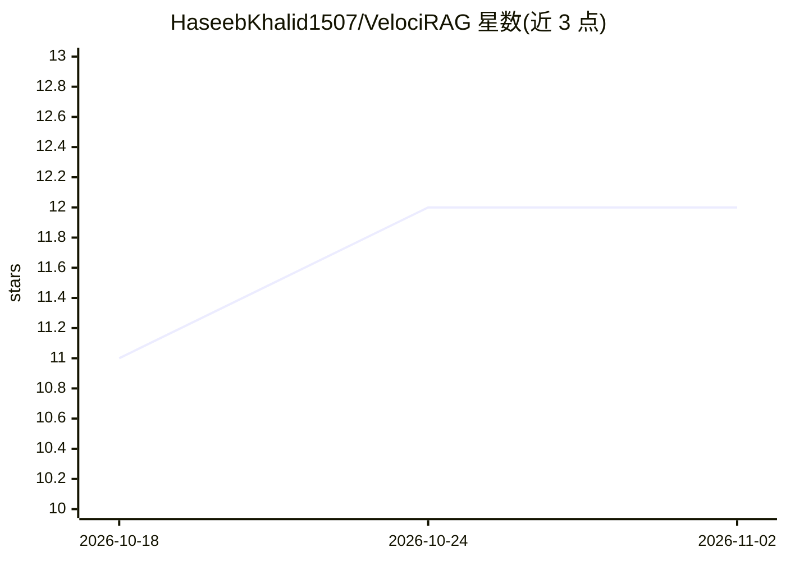

# HaseebKhalid1507/VelociRAG

⭐ 12 · Python · MIT · 推送 2026-04-05 · [GitHub](https://github.com/HaseebKhalid1507/VelociRAG) · [官网](https://pypi.org/project/velocirag/) · 个人维护

**面向 AI agent 的本地 RAG 库：ONNX 四层融合检索，MCP 接入**

面向 AI agent 开发者的检索增强库：在 ONNX Runtime 上运行四层检索（FAISS 向量、SQLite FTS5 BM25、知识图谱遍历、元数据过滤），经 RRF 融合并用 TinyBERT 交叉编码器重排；不依赖 PyTorch 与 GPU，本地 MiniLM + TinyBERT 约 80MB，无需 API key。提供 MCP server（5 个工具）接入 Claude、Cursor、Windsurf，附 CLI、Python API 与 Unix socket 守护进程实现热查询，支持增量图更新与多源隔离。可选 GLiNER NER（需 PyTorch）。

## 筛选速览

| 维度 | 判定 | 备注 |
|---|---|---|
| AI 角色 | `ai-ecosystem` | LLM/agent 周边工具 |
| 许可风险 | `permissive` | MIT |
| 部署形态 | `library` | 以包/库形式分发 |
| 模型依赖 | — | README 未给出锁定关系 |
| 硬件要求 | `cpu-ok` | |
| 安装摩擦 | `low` | 无编译、无系统依赖或容器化 |
| 成熟度 | — | 结构信号不足 |

## 能力要点

- 四层检索（向量/BM25/知识图谱/元数据）+ RRF 融合 + 交叉编码器重排
- 纯 ONNX 推理，无 PyTorch、无 GPU、无 API key，安装约 80MB
- MCP server 提供 search/index/add_document/health/list_sources 五个工具
- 增量图更新与文件级溯源跟踪，仅重建受影响节点/边

## 适用场景

- 为 Claude/Cursor 等 MCP 客户端接入本地文档检索能力
- 在 CPU 机器上为 agent 构建低延迟知识库检索
- 对 markdown 文档建立实体/时序/主题知识图谱并多条件过滤检索

## 场景标签

`RAG` `知识图谱` · 领域:知识与检索

## 证据(README 行号)

> L5: _Four-layer retrieval fusion powered by ONNX Runtime. No PyTorch. Sub-200ms warm search. Incremental graph updates. 
> L7: Most RAG solutions either drag in 2GB+ of PyTorch or limit you to single-layer vector search. VelociRAG gives you fo
> L115: - **MCP server** — Five tools (search, index, add_document, health, list_sources) for Claude, Cursor, Windsurf

## 星数曲线

2026-10-18 11 → 2026-11-02 12（+1）

---
*卡片 v1 · prompt 1.4 · 生成 2026-11-01 · 置信度 high · 依据 README sha `0df926796a6a` · [字段定义](../../DATASET.md)*
