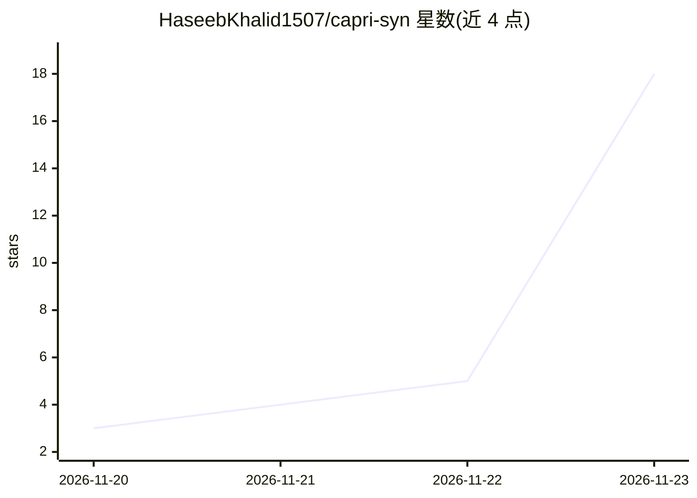

# HaseebKhalid1507/capri-syn

⭐ 18 · Rust · MIT · 推送 2026-11-22 · [GitHub](https://github.com/HaseebKhalid1507/capri-syn) · 个人维护

**Linux/Windows 桌面伴侣宠物，内置 Synaps agent 会话与语音对话**

用 Rust + GPUI 编写的桌面伴侣应用：角色形象栖息在窗口上、随窗口切换移动、在锁定屏幕时入睡，并通过两个后台驱动（漫游/求关注）决定行为。语音与对话部分："Hey Capri" 唤醒，whisper.cpp 做本地语音识别，Kokoro 做本地语音合成，均在 CPU 上运行；文字通过 $mod+C 快捷键的 Line 输入。其智能来自独立的 Synaps agent 会话（由安装器一并安装），支持账号登录、API key 或本地模型三种接入方式。非官方粉丝项目，形象素材来自第三方 Capri 项目。

## 筛选速览

| 维度 | 判定 | 备注 |
|---|---|---|
| AI 角色 | `ai-enhanced` | 去掉 AI 部分产品仍成立 |
| 许可风险 | `permissive` | MIT |
| 部署形态 | `desktop` | 安装包/桌面程序 |
| 模型依赖 | local-ok | 支持本地模型 |
| 硬件要求 | — | 无带数字的原话,不猜 |
| 安装摩擦 | `low` | 无编译、无系统依赖或容器化 |
| 成熟度 | — | 结构信号不足 |

## 能力要点

- 栖息/漫游/求关注/召唤等行为由双驱动机制决定，非脚本预设
- 本地语音链路：whisper.cpp 语音识别 + Kokoro 语音合成，CPU 运行
- 三种模型接入方式：ChatGPT/Claude 等账号登录、API key、Ollama/LM Studio 本地模型
- agent 需要确认时（如危险工具调用）会移动到当前窗口请求用户批准

## 适用场景

- 桌面养成式宠物陪伴，与窗口和工作区联动
- 通过桌面形象与 agent 会话对话并代为执行机器上的操作
- 本地离线语音问答（麦克风 + CPU）

## 场景标签

`语音 Agent` `AI 助手` · 领域:对话与助手

## 证据(README 行号)

> L3:  A living desktop companion with a real agent's brain.
> L37: on your machine, and comes over when she needs a yes from you. Her brain is the real thing: an agent
> L164: |**Her brain**|Synaps 0.11.0 or newer (the installers fetch 0.12.0) and one of: an account (ChatGPT, Claude, Copil

## 星数曲线

2026-11-20 3 → 2026-11-23 18（+15）

---
*卡片 v1 · prompt 1.4 · 生成 2026-11-21 · 置信度 high · 依据 README sha `9735fa738206` · [字段定义](../../DATASET.md)*
