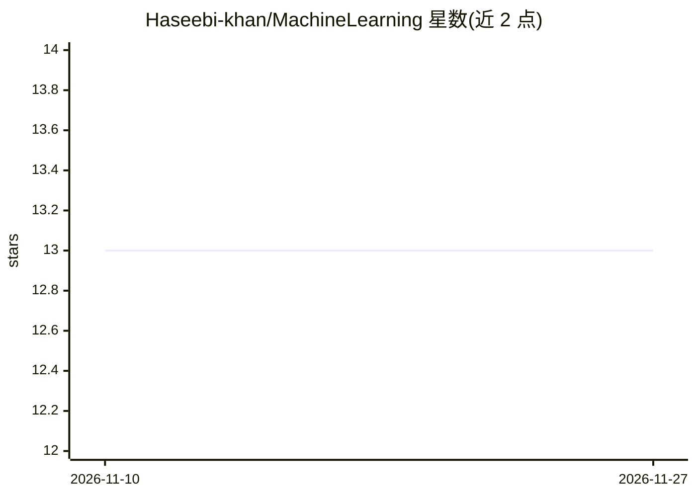

# Haseebi-khan/MachineLearning

⭐ 13 · Jupyter Notebook · MIT · 推送 2026-09-01 · [GitHub](https://github.com/Haseebi-khan/MachineLearning) · 个人维护

**个人机器学习学习与项目实验合集仓库**

个人学习型仓库，收录作者在机器学习领域的学习笔记、练习与项目：涵盖监督/无监督/强化学习的模型实现、模型调优与流水线、深度学习（ANN、CNN、RNN、Transformers）探索，以及用 Flask 与 Streamlit 做的 API 部署，并包含 Aurélien Géron《Hands-On ML》一书的完整实现与案例研究。使用 Python、scikit-learn、PyTorch、TensorFlow 等库。仓库处于持续学习更新状态，未来计划加入 MLOps 流水线与 AutoML 实验。未提供安装说明或使用文档。

## 筛选速览

| 维度 | 判定 | 备注 |
|---|---|---|
| AI 角色 | `ai-knowledge` | 知识聚合/清单类 |
| 许可风险 | `permissive` | MIT |
| 部署形态 | `None` |  |
| 模型依赖 | — | README 未给出锁定关系 |
| 硬件要求 | — | 无带数字的原话,不猜 |
| 安装摩擦 | `low` | 无编译、无系统依赖或容器化 |
| 成熟度 | — | 结构信号不足 |

## 能力要点

- 覆盖监督、无监督与强化学习的模型实现
- 包含 ANN/CNN/RNN/Transformers 深度学习探索
- Flask 与 Streamlit 部署示例
- 《Hands-On ML》全书配套实现

## 适用场景

- 参考他人机器学习入门到部署的学习路径
- 查找常见模型的手写实现示例
- 参考 Flask/Streamlit 的模型部署方式

## 场景标签

`教程课程` · 领域:学习与行业

## 证据(README 行号)

> L3: Welcome to my **Machine Learning Repository** — a complete collection of my learning, projects, and experiments in t
> L8: - Hands-on **Model Implementations** (Supervised, Unsupervised and Reinforcement)

## 星数曲线

2026-11-10 13 → 2026-11-27 13（+0）

---
*卡片 v1 · prompt 1.4 · 生成 2026-11-18 · 置信度 high · 依据 README sha `4517547920c7` · [字段定义](../../DATASET.md)*
