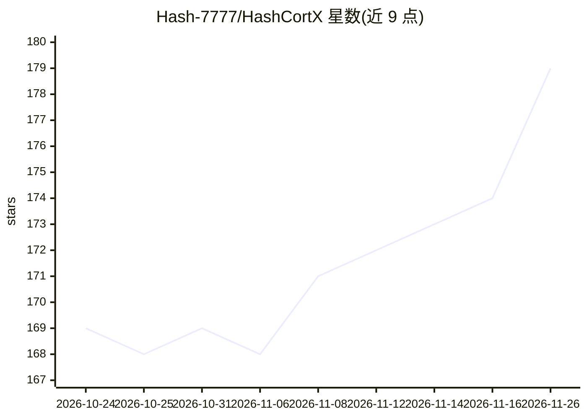

# Hash-7777/HashCortX

⭐ 179 · JavaScript · MIT · 推送 2026-11-15 · [GitHub](https://github.com/Hash-7777/HashCortX) · [官网](https://hashcortx.com/) · 个人维护

**本地优先的 AI 桌面工作台：多模型聊天、编码 agent 与多智能体协作**

基于 Tauri v2 的原生桌面应用，提供七个工作区：多模型并排聊天、针对真实项目的编码 agent HashCoder、画布式多智能体团队、3D 零件生成、ERP 应用构建、财务数据读取与不可信代码沙箱。模型接入使用用户自己的 API key，支持本地模型离线运行；内置 bge-small-en-v1.5 的本地 RAG，PDF 与笔记在本机索引检索。限制：密钥以未加密方式存储，构建未经代码签名，macOS/Windows 提供安装包。MIT 许可，无后端、无遥测、无账号。

## 筛选速览

| 维度 | 判定 | 备注 |
|---|---|---|
| AI 角色 | `ai-native` | 本体是模型或模型工具 |
| 许可风险 | `permissive` | MIT |
| 部署形态 | `library` | 以包/库形式分发 |
| 模型依赖 | local-ok | 支持本地模型 |
| 硬件要求 | — | 无带数字的原话,不猜 |
| 安装摩擦 | `low` | 无编译、无系统依赖或容器化 |
| 成熟度 | `idea` | |

## 能力要点

- 接入二十一家云服务商、Ollama 及兼容通用聊天格式的本地模型应用
- HashCoder 编码 agent：diff 保留/撤销、内置终端跑测试、按模型规模分三档 harness
- 本地 RAG：bge-small-en-v1.5 向量与关键词双索引，RRF 融合检索，全程离线
- Agent Swarm 画布编排多模型智能体团队，支持失败 agent 单独重跑

## 适用场景

- 用自有 API key 在一个桌面端对比并使用多家云模型
- 在真实代码仓库中让编码 agent 按 diff 与测试验证完成修改
- PDF 与笔记全部留在本机做检索增强问答
- 在画布上组建多 agent 团队完成建站等任务

## 场景标签

`编码 Agent` `多智能体` `RAG` `AI 助手` · 领域:Agent 开发

## 证据(README 行号)

> L30:  Every model, side by side Twenty-one cloud providers, Ollama, and any local model app that speaks the common chat 
> L66:  HashCoder A coding agent on your real project: file tree, diffs, terminal, Undo
> L99: HashCortx answers from your own files without sending them anywhere to be indexed. Retrieval-augmented generation (

## 星数曲线

2026-10-24 169 → 2026-11-26 179（+10）

---
*卡片 v1 · prompt 1.4 · 生成 2026-11-26 · 置信度 mid · 依据 README sha `44e8ec0fd9f9` · [字段定义](../../DATASET.md)*
