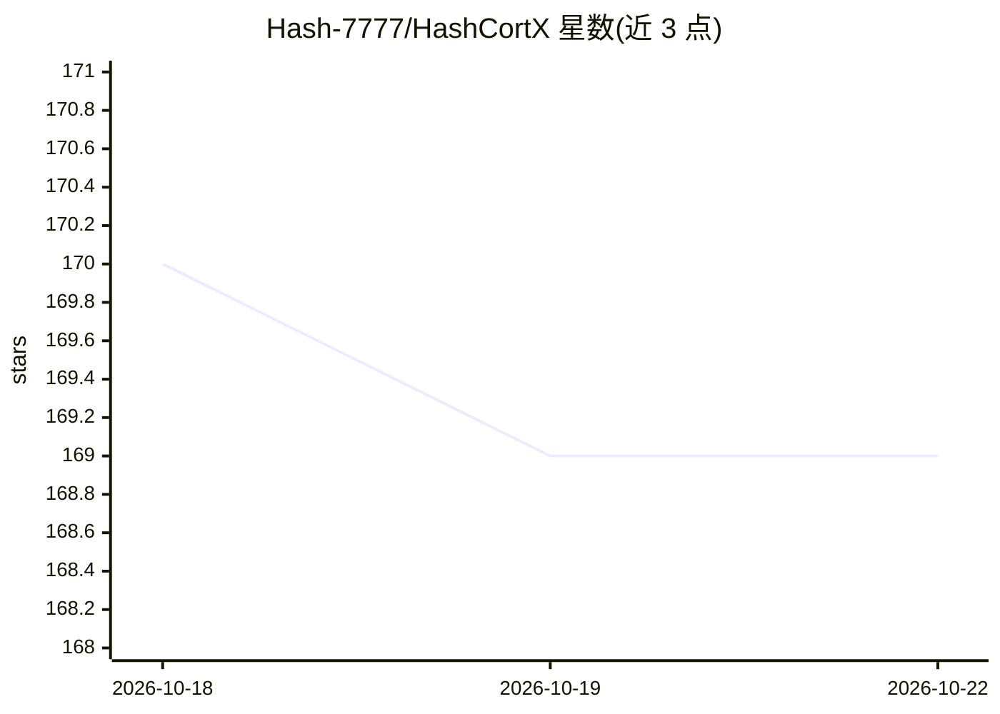

# Hash-7777/HashCortX

⭐ 169 · JavaScript · MIT · 推送 2026-10-20 · [GitHub](https://github.com/Hash-7777/HashCortX) · [官网](https://hashcortx.com/) · 个人维护

**本地优先 AI 桌面工作台：多模型对话、编码 agent 与本地 RAG**

基于 Tauri v2 的原生桌面应用（macOS Apple Silicon / Windows 10），无后端、无遥测、无账号，MIT 许可。提供七个工作区：多提供商聊天、带 harness 的编码 agent HashCoder（diff、测试验证、权限模式、按模型规模分级）、Agent Swarm 多智能体团队、文本生成 3D 零件（STL/OBJ/3MF/STEP）、ERP 应用生成、财务报表读取与 Sandbox 恶意代码检查。内置本地 RAG 知识库，嵌入模型 bge-small-en-v1.5 经 ONNX Runtime 编译进 Rust 核心；支持 21 个云提供商、Ollama 及本地模型。限制：密钥未加密存储、构建未签名。

## 筛选速览

| 维度 | 判定 | 备注 |
|---|---|---|
| AI 角色 | `ai-native` | 本体是模型或模型工具 |
| 许可风险 | `permissive` | MIT |
| 部署形态 | `library` | 以包/库形式分发 |
| 模型依赖 | local-ok | 支持本地模型 |
| 硬件要求 | — | 无带数字的原话,不猜 |
| 安装摩擦 | `low` | 无编译、无系统依赖或容器化 |
| 成熟度 | — | 结构信号不足 |

## 能力要点

- HashCoder harness：diff 编辑、运行测试自证、按模型规模（<5B/5-15B/15B+）分级工具
- 本地 RAG：bge-small-en-v1.5 嵌入 + 关键词双索引，倒数排名融合，离线可用
- 支持 21 个云提供商与 Ollama 等本地模型，密钥自持
- 安全机制：审计日志、Rust 编译的密钥/凭据黑名单、macOS 沙箱运行

## 适用场景

- 在一个桌面应用中同时使用多个 AI 提供商的模型对话
- 让编码 agent 在真实项目上按权限模式改代码并用测试验证
- 在本机对 PDF 和笔记做语义+关键词检索问答，文件不出机器
- 用 Agent Swarm 组建多智能体团队完成建站或建模任务

## 场景标签

`多智能体` `编码 Agent` `RAG` `聊天机器人` · 领域:Agent 开发

## 证据(README 行号)

> L5: ### Every AI model. One desktop. Nothing leaves without you.
> L34: |**Every model, side by side**|Twenty-one cloud providers, Ollama, and any local model app that speaks the common c
> L71: |**Chats**|Every provider in one conversation, with projects, attachments, memory, a local knowledge base, a queue 

## 星数曲线

2026-10-18 170 → 2026-10-22 169（-1）

---
*卡片 v1 · prompt 1.4 · 生成 2026-10-22 · 置信度 high · 依据 README sha `bdd45378257b` · [字段定义](../../DATASET.md)*
