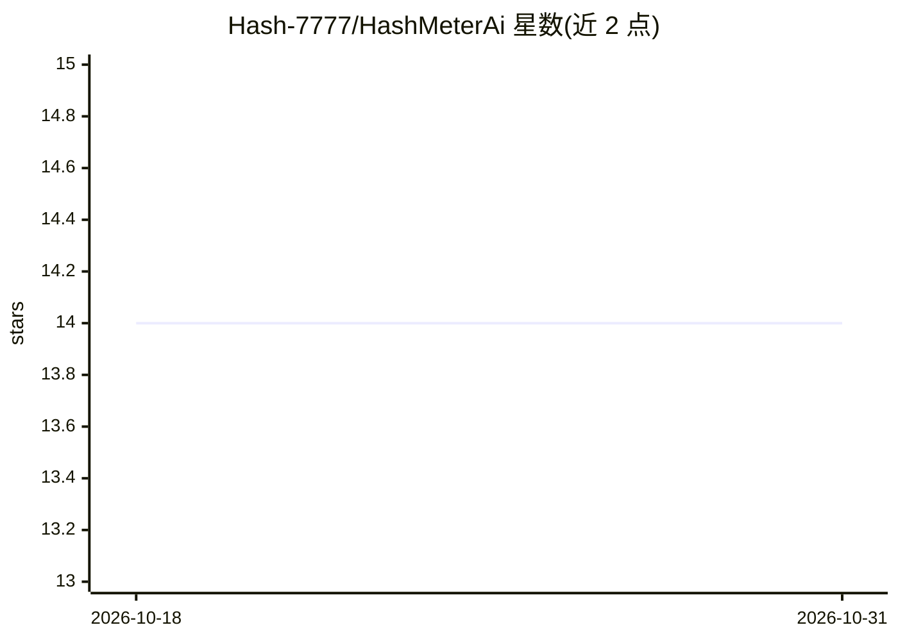

# Hash-7777/HashMeterAi

⭐ 14 · Rust · Apache-2.0 · 推送 2026-07-21 · [GitHub](https://github.com/Hash-7777/HashMeterAi) · [官网](https://hashmeterai.com) · 个人维护

**本地离线的 AI 编程工具用量统计仪表盘**

读取 Claude Code、Codex、Kimi、Qwen CLI 等本地转写文件（仅 token 数、时间戳与模型名），在统一仪表盘中展示估算 API 费用、处理 token 数、专注时长、AI 人设画像、60 个成就、活动日历与可导出分享卡。零网络、无遥测、只读不修改数据。基于 Tauri v2 + Rust 构建，提供 macOS/Windows/Linux 安装包，也可从源码构建。

## 筛选速览

| 维度 | 判定 | 备注 |
|---|---|---|
| AI 角色 | `ai-ecosystem` | LLM/agent 周边工具 |
| 许可风险 | `permissive` | Apache-2.0 |
| 部署形态 | `desktop` | 安装包/桌面程序 |
| 模型依赖 | — | README 未给出锁定关系 |
| 硬件要求 | — | 无带数字的原话,不猜 |
| 安装摩擦 | `low` | 无编译、无系统依赖或容器化 |
| 成熟度 | — | 结构信号不足 |

## 能力要点

- 读取本地转写文件的元数据估算费用与处理 token 数
- 支持 Claude Code、Codex、Kimi、Qwen CLI、HashCortx、HashCerebrum
- 零网络、只读、不读取提示词或凭据的隐私设计
- 可插拔源适配器架构，新增工具只需一个 Rust 文件

## 适用场景

- 查看多个 AI 编程工具的统一用量与费用估算
- 生成用量统计分享卡发布
- 离线追踪每日 AI 编程活动与成就

## 场景标签

 · 领域:开发者工具/AI 用量监控

## 证据(README 行号)

> L6: Claude Code, Codex, Kimi, Qwen CLI, HashCortx, HashCerebrum — unified into one clean dashboard with usage based trop
> L13: > Your tools' built-in meters skip sessions, miss whole days, and only count themselves. **HashMeterAi reads the ra
> L33: |**Metadata only**|Reads token counts, timestamps, and model names — never your prompts, code, or replies.|

## 星数曲线

2026-10-18 14 → 2026-10-31 14（+0）

---
*卡片 v1 · prompt 1.4 · 生成 2026-10-31 · 置信度 mid · 依据 README sha `17e59a3b3cc8` · [字段定义](../../DATASET.md)*
