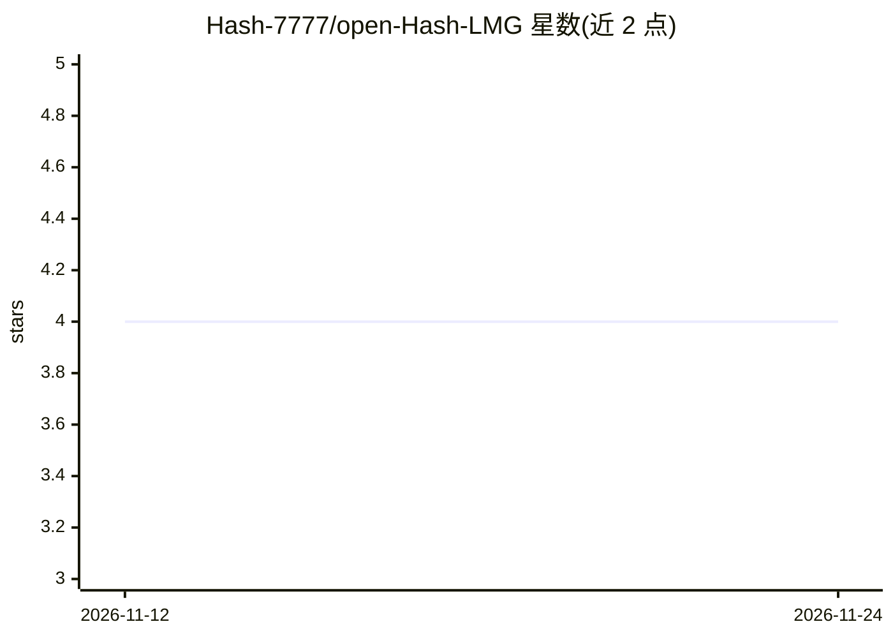

# Hash-7777/open-Hash-LMG

⭐ 4 · JavaScript · GPL-3.0 · 推送 2026-11-08 · [GitHub](https://github.com/Hash-7777/open-Hash-LMG) · [官网](https://openhashlmg.com) · 个人维护

**本地运行动画工具：一句话生成动态图形影片并导出**

基于 Tauri v2 的桌面应用，用户输入一句简报后由本地或云端 LLM 撰写分镜，应用自身完成排版、动态文字、运动、配乐、旁白与视频导出（MP4/MOV/WebM/GIF，480p–4K）。支持 Ollama、LM Studio、llama.cpp 本地模型与十二家云服务自有 key，按模型规模建议 Guided/Plan/Code 三种工作方式，并对渲染帧做规则化自检修复。当前 macOS Apple Silicon 可用安装包，任意系统可从源码运行；仅在 macOS 上被运行过。

## 筛选速览

| 维度 | 判定 | 备注 |
|---|---|---|
| AI 角色 | `ai-native` | 本体是模型或模型工具 |
| 许可风险 | `viral` | GPL-3.0 |
| 部署形态 | `desktop` | 安装包/桌面程序 |
| 模型依赖 | local-ok | 支持本地模型 |
| 硬件要求 | — | 无带数字的原话,不猜 |
| 安装摩擦 | `medium` | 含编译或系统依赖之一 |
| 成熟度 | `idea` | |

## 能力要点

- 本地模型即可产出完整影片，3B 参数模型在笔记本上运行过
- 帧级自检：渲染后测量出框、过小、过快等问题并按规则修复
- 支持 Ollama/LM Studio/llama.cpp 本地模型与 12 家云服务自有 key
- 无账号无服务器，本地模型时全流程离线

## 适用场景

- 为自己的产品快速生成一部介绍用的动态图形影片
- 在笔记本上用本地模型离线制作动画短片
- 制作带动态文字与原创配乐的宣传视频并导出多种格式

## 场景标签

`视频生成` · 领域:内容生成

## 证据(README 行号)

> L5: ### One sentence in. A finished motion-graphics film out.
> L110: **On your computer:** Ollama, LM Studio and llama.cpp, asked by the desktop app, so no server switch is needed.

## 星数曲线

2026-11-12 4 → 2026-11-24 4（+0）

---
*卡片 v1 · prompt 1.4 · 生成 2026-11-21 · 置信度 high · 依据 README sha `b51fd42c50db` · [字段定义](../../DATASET.md)*
