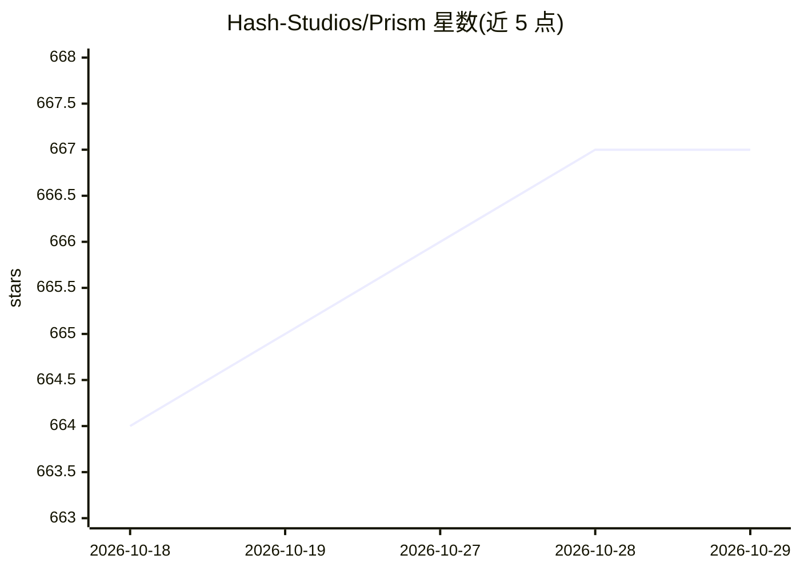

# Hash-Studios/Prism

⭐ 667 · Dart · BSD-3-Clause · 推送 2026-10-28 · [GitHub](https://github.com/Hash-Studios/Prism) · [官网](https://play.google.com/store/apps/details?id=com.hash.prism) · 组织维护

**面向 Android/iOS 的开源壁纸应用，含 AI 文生壁纸功能**

由 Hash Studios 用 Flutter/Dart 开发的开源壁纸应用：聚合社区上传、Wallhaven 与 Pexels 的壁纸到一个按偏好学习的 feed，支持按关键词/颜色/标签搜索、带时钟的预览、滤镜编辑、动态壁纸（Android）、Prism Coins 积分与 Prism Pro 订阅。AI 部分：从文本提示生成壁纸并创建变体、分享结果。Android 经 Google Play 分发，源码含 Firebase 后端、Cloudflare Worker 与 Next.js 网站；开发需 FVM、Doppler 密钥与 Firebase 配置。

## 筛选速览

| 维度 | 判定 | 备注 |
|---|---|---|
| AI 角色 | `ai-enhanced` | 去掉 AI 部分产品仍成立 |
| 许可风险 | `permissive` | BSD-3-Clause |
| 部署形态 | `None` |  |
| 模型依赖 | — | README 未给出锁定关系 |
| 硬件要求 | — | 无带数字的原话,不猜 |
| 安装摩擦 | `low` | 无编译、无系统依赖或容器化 |
| 成熟度 | — | 结构信号不足 |

## 能力要点

- 聚合社区、Wallhaven、Pexels 三方壁纸源到个性化 feed
- 从文本提示生成 AI 壁纸并创建变体
- 带时钟预览、滤镜编辑、动态壁纸与自动轮换（部分为 Pro 功能）
- iOS 通过 Shortcuts 自动化自动换壁纸

## 适用场景

- 浏览并一键设置壁纸，支持按颜色搜索
- 用 AI 从文字提示生成个性化壁纸
- 上传自己的作品、关注创作者并参与社区

## 场景标签

`图像生成` `图像视频处理` · 领域:内容生成

## 证据(README 行号)

> L48: - Generate AI wallpapers from text prompts, create variations, and share the results.
> L21: Prism brings wallpapers from the community, Wallhaven, and Pexels into one feed that learns what you like.

## 星数曲线

2026-10-18 664 → 2026-10-29 667（+3）

---
*卡片 v1 · prompt 1.4 · 生成 2026-10-21 · 置信度 high · 依据 README sha `3fef7d1f4ccf` · [字段定义](../../DATASET.md)*
