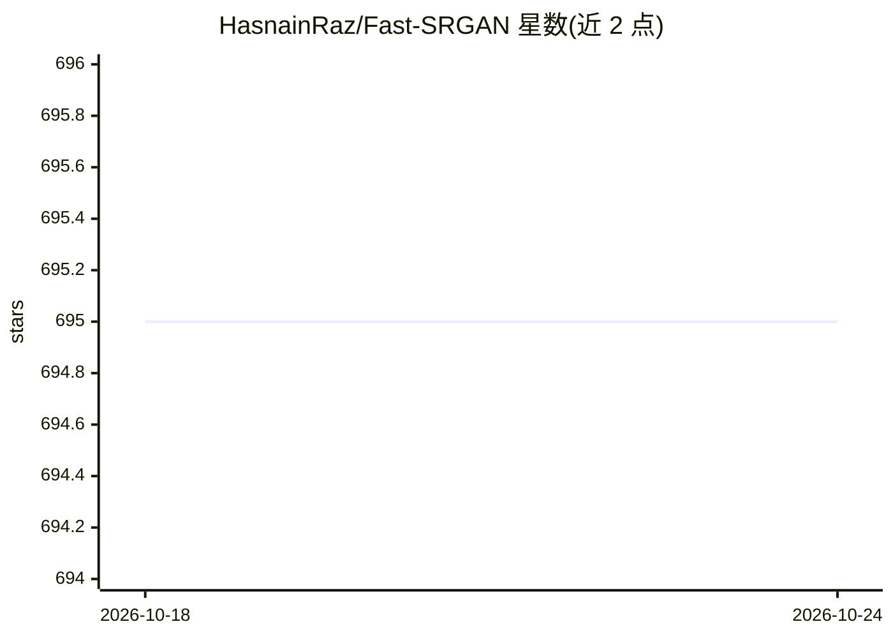

# HasnainRaz/Fast-SRGAN

⭐ 695 · Python · MIT · 推送 2026-10-23 · [GitHub](https://github.com/HasnainRaz/Fast-SRGAN) · 个人维护

**面向低清视频实时超分的 SR-GAN 实现（M1 上 30fps）**

基于 SR-GAN 架构的单图像超分辨率深度学习模型，采用 pixel shuffle 上采样以提升速度。README 提供在 MacBook M1 Pro（MPS）上的速度基准：90x160 输入约 82 FPS，180x320 输入约 27 FPS，即 720p 上采样接近 30fps。仓库附带在 DIV2k 数据集上训练的预训练生成器（8 个残差块、每层 64 filters），支持 inference.py 对图像目录推理、train.py 训练，配置基于 hydra，训练记录保存到 tensorboard。测试环境为 Python 3.10，通过 Pipfile 安装依赖。

## 筛选速览

| 维度 | 判定 | 备注 |
|---|---|---|
| AI 角色 | `ai-native` | 本体是模型或模型工具 |
| 许可风险 | `permissive` | MIT |
| 部署形态 | `library` | 以包/库形式分发 |
| 模型依赖 | — | README 未给出锁定关系 |
| 硬件要求 | — | 无带数字的原话,不猜 |
| 安装摩擦 | `low` | 无编译、无系统依赖或容器化 |
| 成熟度 | — | 结构信号不足 |

## 能力要点

- SR-GAN 架构 + pixel shuffle 上采样实现实时超分
- 提供 DIV2k 预训练生成器（8 残差块/64 filters）
- M1 Pro MPS 上 720p 输出约 27 FPS 的基准数据
- hydra 配置管理 + tensorboard 训练监控

## 适用场景

- 把低分辨率视频/图像上采样到高清
- 在 Apple Silicon 上做近实时超分推理
- 用自己的数据集训练 SR-GAN 超分模型

## 场景标签

`图像视频处理` `模型训练` · 领域:感知与多模态

## 证据(README 行号)

> L2: The goal of this repository is to enable real time super resolution for upsampling low resolution videos. Currently,
> L14: We see it's possible to upsample to 720p at around 30fps.

## 星数曲线

2026-10-18 695 → 2026-10-24 695（+0）

---
*卡片 v1 · prompt 1.4 · 生成 2026-10-21 · 置信度 high · 依据 README sha `65113723b1bb` · [字段定义](../../DATASET.md)*
