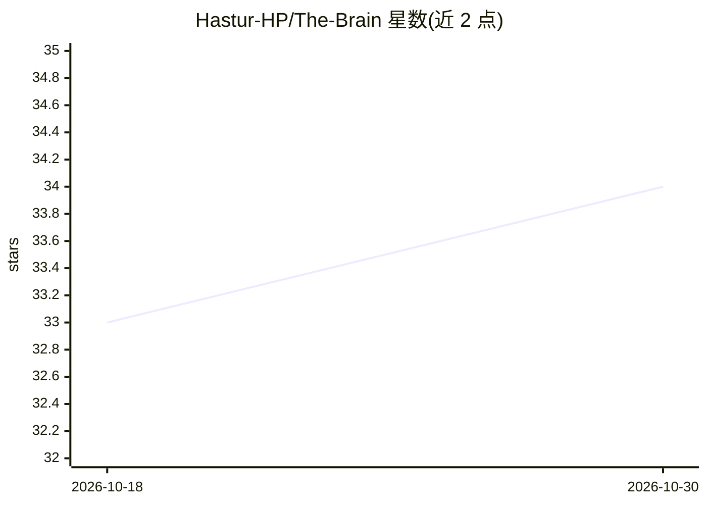

# Hastur-HP/The-Brain

⭐ 34 · JavaScript · MIT · 推送 2026-03-23 · [GitHub](https://github.com/Hastur-HP/The-Brain) · 个人维护

**多模态 RAG 仪表盘与 3D 知识图谱可视化应用**

基于 LightRAG 与 RAG-Anything 构建的 RAG 仪表盘与 3D 知识图谱可视化器：通过 MinerU 解析 PDF（版面检测、OCR、多模态抽取），将文本、图像、表格、公式摄入 Neo4j 图数据库与 NanoVectorDB 向量库，提供仪表盘、文档队列、实时日志、查询对话与可交互 3D 图谱界面。支持本地模型（Ollama/llama.cpp/vLLM/LM Studio）或任意 OpenAI 兼容云端 API，默认使用 BAAI/bge-reranker-v2-m3 重排器，以 Docker Compose 部署。

## 筛选速览

| 维度 | 判定 | 备注 |
|---|---|---|
| AI 角色 | `ai-native` | 本体是模型或模型工具 |
| 许可风险 | `permissive` | MIT |
| 部署形态 | `self-host` | docker 或自建部署 |
| 模型依赖 | local-ok | 支持本地模型 |
| 硬件要求 | — | 无带数字的原话,不猜 |
| 安装摩擦 | `low` | 无编译、无系统依赖或容器化 |
| 成熟度 | — | 结构信号不足 |

## 能力要点

- 摄入文本/图像/表格/方程等多模态文档并构建知识图谱
- 支持 ollama/llamacpp/vllm/lmstudio/openai 五种引擎切换
- Web UI 覆盖仪表盘、文档队列、实时日志、查询与 3D 图谱浏览
- Docker Compose 一键部署，数据存储于命名卷

## 适用场景

- 本地离线处理 PDF 等文档并搭建个人知识库问答
- 通过 3D 图谱浏览文档中的实体与关系
- 在查询界面查看检索到的图谱实体与片段

## 场景标签

`RAG` `知识图谱` `文档问答` · 领域:知识与检索

## 证据(README 行号)

> L4: The Brain is a Retrieval-Augmented Generation (RAG) dashboard and 3D Knowledge Graph visualizer. It is designed to i
> L6: The system is built on top of the LightRAG and RAG-Anything frameworks. It supports fully offline execution via loca

## 星数曲线

2026-10-18 33 → 2026-10-30 34（+1）

---
*卡片 v1 · prompt 1.4 · 生成 2026-10-25 · 置信度 high · 依据 README sha `493fddc7a128` · [字段定义](../../DATASET.md)*
