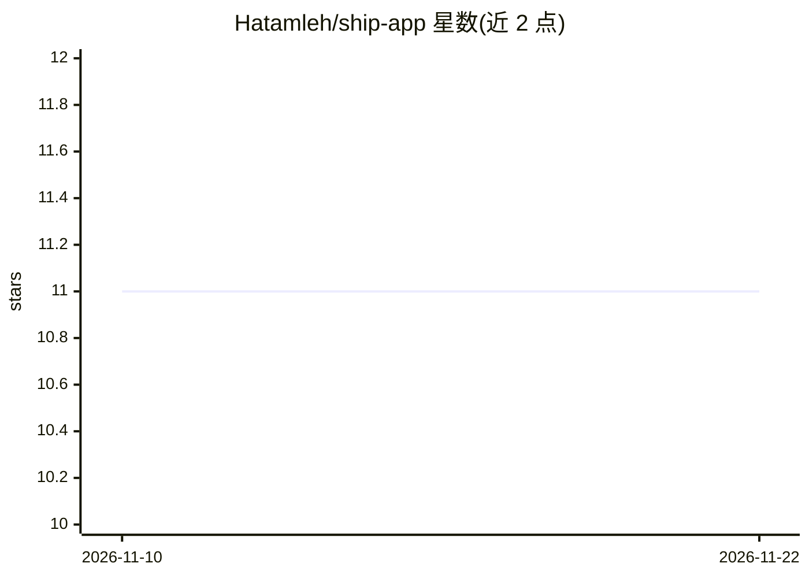

# Hatamleh/ship-app

⭐ 11 · TypeScript · 推送 2026-08-07 · [GitHub](https://github.com/Hatamleh/ship-app) · [官网](https://qacart.com) · 个人维护

**教学软件测试用的发货管理应用，内置 AI 助手**

基于 SvelteKit + TypeScript + Prisma/SQLite 的发货管理应用，为软件测试教学而建，练习范围覆盖手工测试、UI 自动化（无 data-testid，依赖可访问性定位器）、API 测试与 AI/agent 测试。内置一个 LangChain agent 助手：读取运单、调用真实定价引擎计价、基于项目文档的 RAG 回答发货规则，并可代填表单；AI 功能为可选项，未配置时返回 503 提示。README 不含测试用例，编写测试本身是练习内容。

## 筛选速览

| 维度 | 判定 | 备注 |
|---|---|---|
| AI 角色 | `ai-enhanced` | 去掉 AI 部分产品仍成立 |
| 许可风险 | `none` | — |
| 部署形态 | `library` | 以包/库形式分发 |
| 模型依赖 | locked-api |  |
| 硬件要求 | — | 无带数字的原话,不猜 |
| 安装摩擦 | `low` | 无编译、无系统依赖或容器化 |
| 成熟度 | — | 结构信号不足 |

## 能力要点

- 内置 LangChain agent：读运单、调真实定价引擎、RAG 回答规则、代填表单
- 文档索引通过 OpenRouter 生成嵌入并本地存储（npm run ingest）
- 无 data-testid 设计，所有控件通过可访问性定位器（getByRole/getByLabel）可达
- 本地 SQLite 数据库，无需数据库服务器、Docker 或云账号

## 适用场景

- 教学中练习手工测试、UI 自动化与 API 测试
- 练习针对 LLM agent 应用的 AI 测试
- 课程中学生各自用自己的 API key 运行 AI 助手功能

## 场景标签

`教程课程` · 领域:学习与行业

## 证据(README 行号)

> L3: A shipping management app used for teaching software testing — manual testing,
> L6: It ships with an AI assistant: a LangChain agent that can read your shipments,
> L70: ## Enabling the AI assistant (optional)

## 星数曲线

2026-11-10 11 → 2026-11-22 11（+0）

---
*卡片 v1 · prompt 1.4 · 生成 2026-11-19 · 置信度 high · 依据 README sha `308866fa94dc` · [字段定义](../../DATASET.md)*
