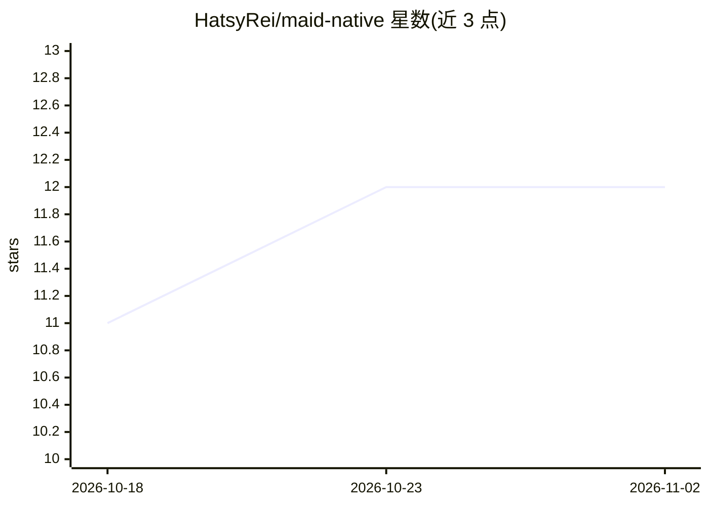

# HatsyRei/maid-native

⭐ 12 · Kotlin · MIT · 推送 2026-10-30 · [GitHub](https://github.com/HatsyRei/maid-native) · 个人维护 · 中文 README

**连接任意 OpenAI 兼容接口的原生 Android 聊天客户端**

用 Kotlin/Jetpack Compose 编写的 Material 3 风格原生 Android 应用，直连任意 OpenAI 兼容 API 端点（无账号、无遥测、无广告，APK 约 2.0 MB）。功能包括流式 Markdown 聊天、分支对话树、多模态附件、LAN 端点发现、加密存储 API key、离线浏览历史、推理内容折叠、生成统计、采样控制、内置工具调用（日期/骰子/Fetch URL/沙箱 JS）、关联文件编辑、以及远程 MCP 服务器接入（Streamable HTTP，不支持 stdio/SSE/OAuth）。提供英/简中界面。从 React Native 版 Maid 移植，移植已完成。构建需 Android SDK 与 JDK 21，通过 Gradle 或 build.sh 编译。

## 筛选速览

| 维度 | 判定 | 备注 |
|---|---|---|
| AI 角色 | `ai-native` | 本体是模型或模型工具 |
| 许可风险 | `permissive` | MIT |
| 部署形态 | `None` |  |
| 模型依赖 | — | README 未给出锁定关系 |
| 硬件要求 | — | 无带数字的原话,不猜 |
| 安装摩擦 | `medium` | 含编译或系统依赖之一 |
| 成熟度 | — | 结构信号不足 |

## 能力要点

- 流式 Markdown 聊天与分支对话树（编辑/重生成/兄弟切换）
- LAN 子网扫描自动发现本地 llama.cpp / OpenAI 兼容服务器
- 内置工具调用（沙箱 JS、Fetch URL 等，Off/Ask/Allow 三态控制）与 MCP 远程服务器接入
- API key 用 AndroidKeyStore AES/GCM 加密，历史存 Room 可离线浏览

## 适用场景

- 在手机上连接自建或第三方 LLM 端点聊天
- 搭配本地 llama.cpp 服务器做局域网移动端对话
- 让模型调用内置或 MCP 工具完成取数与文件编辑任务

## 场景标签

`聊天机器人` · 领域:对话与助手

## 证据(README 行号)

> L5: A lightweight, Material 3 themed native Android client for OpenAI-compatible
> L38:  to find a local llama.cpp / OpenAI-compatible server without typing an IP.

## 星数曲线

2026-10-18 11 → 2026-11-02 12（+1）

---
*卡片 v1 · prompt 1.4 · 生成 2026-11-01 · 置信度 high · 依据 README sha `94e43cadf14e` · [字段定义](../../DATASET.md)*
