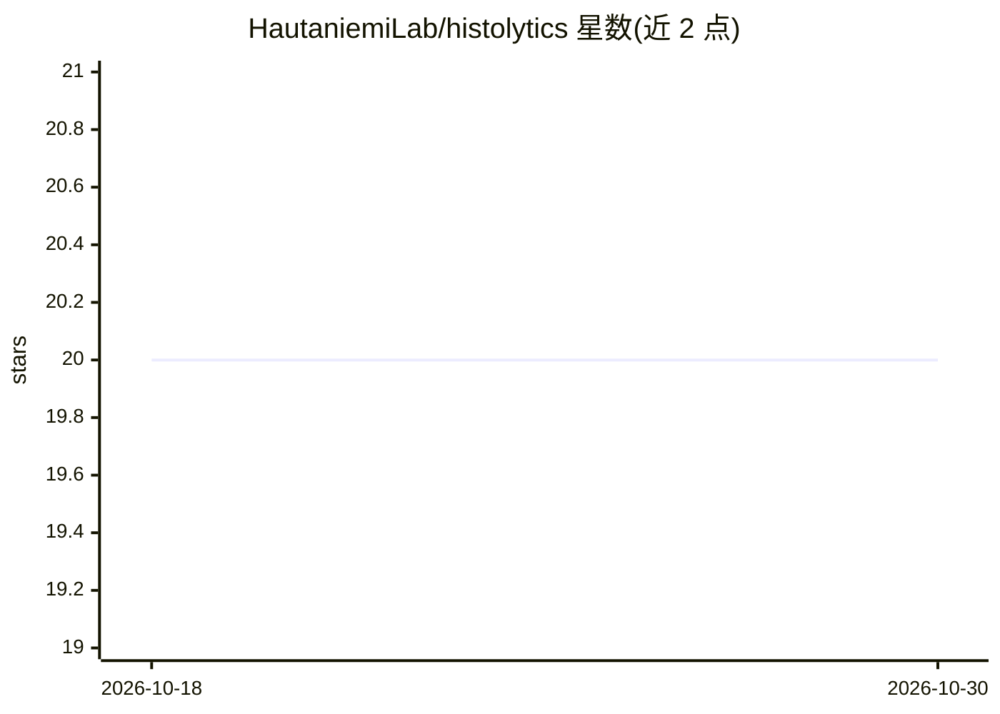

# HautaniemiLab/histolytics

⭐ 20 · Python · BSD-3-Clause · 推送 2026-10-20 · [GitHub](https://github.com/HautaniemiLab/histolytics) · [官网](https://hautaniemilab.github.io/histolytics/) · 组织维护

**面向病理全切片图像的全景分割与空间分析 Python 库**

基于 torch、geopandas 和 libpysal 构建的组织病理学 WSI 分析库，提供可扩展的全景分割框架，包含 Panoptic HoVer-Net、Cellpose、Stardist 等多种模型架构与预训练权重；分割之外提供空间查询、空间索引、图式邻域分析、聚类与大量细胞核/胶原纤维形态学特征。面向数字病理科研用户，支持 pip 多种安装组合（all/segmentation/cucim/cuda-analysis），CUDA 相关组件仅限 Linux。

## 筛选速览

| 维度 | 判定 | 备注 |
|---|---|---|
| AI 角色 | `ai-native` | 本体是模型或模型工具 |
| 许可风险 | `permissive` | BSD-3-Clause |
| 部署形态 | `library` | 以包/库形式分发 |
| 模型依赖 | — | README 未给出锁定关系 |
| 硬件要求 | — | 无带数字的原话,不猜 |
| 安装摩擦 | `medium` | 含编译或系统依赖之一 |
| 成熟度 | — | 结构信号不足 |

## 能力要点

- WSI 级全景分割，多种模型架构与预训练权重
- 低内存占用的矢量化分割输出（geojson/feather/parquet）
- 空间索引、图式邻域分析与空间聚类
- 细胞核形态/染色质/纹理及胶原纤维特征集

## 适用场景

- 对病理切片做肿瘤微环境与免疫浸润空间分析
- 在 WSI 上运行细胞核全景分割并导出矢量结果
- 研究细胞邻域与 TLS/淋巴聚集体的空间统计

## 场景标签

`目标检测` `科研工具` · 领域:学习与行业

## 证据(README 行号)

> L10: **histolytics** is a spatial analysis library for histological whole slide images (WSI). Built upon `torch`, `geopa
> L72: Lehtonen, O., Nordlund, N., Salloum, S., Kalliala, I., Virtanen, A., & Hautaniemi, S. (2025). **Histolytics: A pano

## 星数曲线

2026-10-18 20 → 2026-10-30 20（+0）

---
*卡片 v1 · prompt 1.4 · 生成 2026-10-28 · 置信度 high · 依据 README sha `8f41dacc41af` · [字段定义](../../DATASET.md)*
