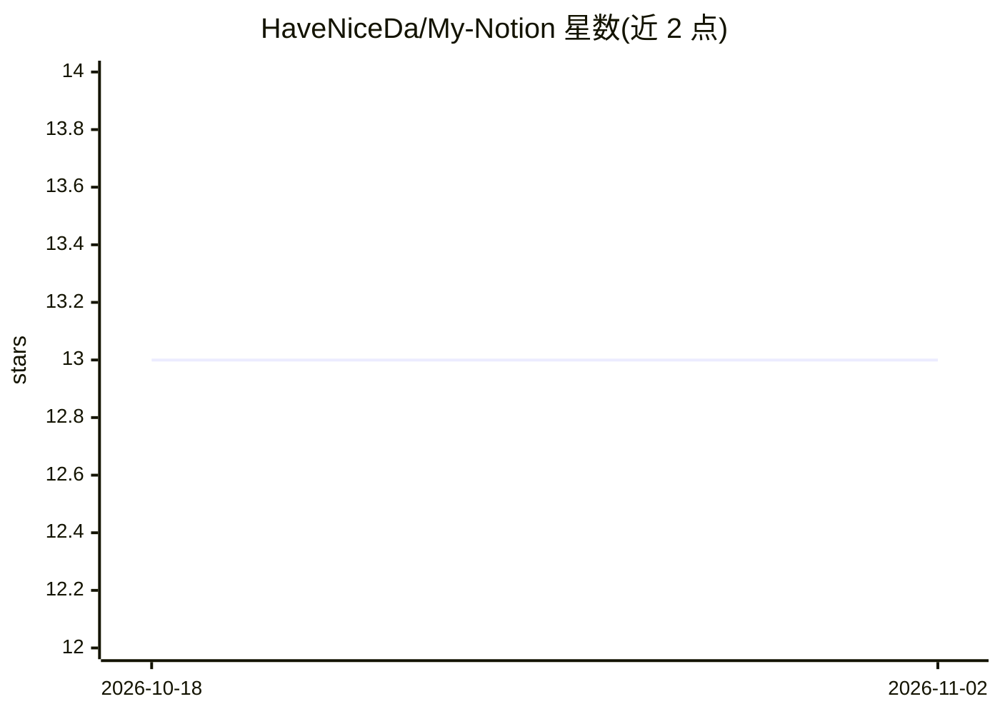

# HaveNiceDa/My-Notion

⭐ 13 · TypeScript · MIT · 推送 2026-10-16 · [GitHub](https://github.com/HaveNiceDa/My-Notion) · [官网](https://notion-j9zj.vercel.app/) · 个人维护 · 中文 README

**个人版 Notion 全栈应用：文档编辑 + AI Agent + CLI/MCP 生态**

pnpm monorepo 工程的定制化个人 Notion：Web 端为 Next.js + Convex + Clerk + BlockNote，覆盖文档树、编辑、发布、收藏、归档、回收站；内置 Web Agent（ReAct Loop、结构感知 RAG、Memory、确认式写入、流式续跑）与 Expo 移动端工作区。另发布独立 npm 包 @mynotion/cli 与 @mynotion/mcp，供外部 Agent 通过 CLI/MCP/Skills 安全读写文档。移动端 Agent Stream 与弱网恢复仍在补齐。

## 筛选速览

| 维度 | 判定 | 备注 |
|---|---|---|
| AI 角色 | `ai-enhanced` | 去掉 AI 部分产品仍成立 |
| 许可风险 | `permissive` | MIT |
| 部署形态 | `library` | 以包/库形式分发 |
| 模型依赖 | — | README 未给出锁定关系 |
| 硬件要求 | — | 无带数字的原话,不猜 |
| 安装摩擦 | `low` | 无编译、无系统依赖或容器化 |
| 成熟度 | — | 结构信号不足 |

## 能力要点

- Web Agent 覆盖 ReAct、RAG、Memory、dry-run 写入与流式续跑闭环
- @mynotion/cli 与 @mynotion/mcp 独立发布，支持外部 Agent 读写文档
- Web/Mobile 共享 AI、业务状态、Convex schema 的跨端架构
- 验证链路含 Agent 单测、CLI/MCP E2E 与 Skills 漂移检查

## 适用场景

- 自部署一套带 AI Agent 的个人 Notion 文档工作区
- 让外部 Agent 通过 MCP/CLI 安全读写我的文档
- 在移动端继续使用文档工作区与 AI Chat

## 场景标签

`知识库管理` · 领域:知识与检索

## 证据(README 行号)

> L3: 定制化个人版 Notion。它不是单纯的编辑器 demo，而是一套把 Web 文档编辑、移动端工作区、AI Agent、RAG/Memory、CLI/Skills/MCP Agent 生态放在同一个 pnpm monorepo 里的
> L37: - **Web Agent**：ReAct Loop、结构感知 RAG、Memory MVP、联网搜索、网页抽取、文档读写 dry-run、确认式写入、`task_plan`、受控 MCP adapter、`tool-result

## 星数曲线

2026-10-18 13 → 2026-11-02 13（+0）

---
*卡片 v1 · prompt 1.4 · 生成 2026-10-31 · 置信度 high · 依据 README sha `13ec193754c2` · [字段定义](../../DATASET.md)*
