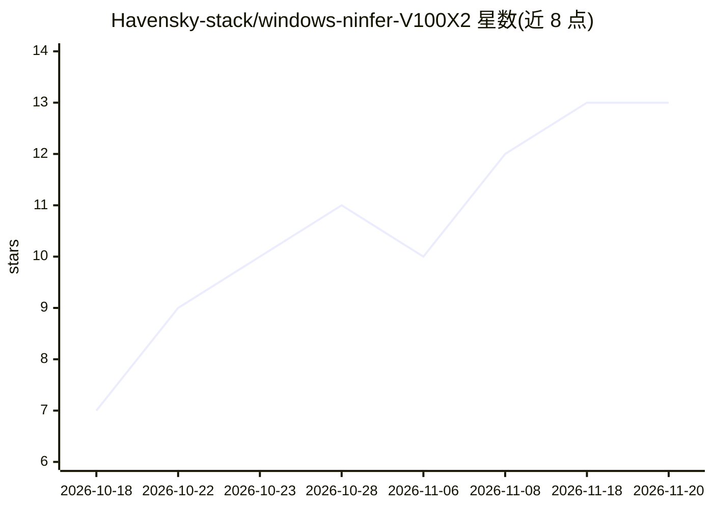

# Havensky-stack/windows-ninfer-V100X2

⭐ 13 · C++ · Apache-2.0 · 推送 2026-10-27 · [GitHub](https://github.com/Havensky-stack/windows-ninfer-V100X2) · [官网](https://github.com/Havensky-stack/windows-ninfer-V100X2/releases) · 个人维护 · 中文 README

**让 Windows 双 Tesla V100 用户本地运行 Qwen 模型的推理发行包**

面向双卡用户的 Windows 本地大模型推理项目：提供中文便携启动器（显卡检查、模型下载校验、启动参数配置、TCC/WDDM 切换）与原生 C++/CUDA CLI/API。围绕已登记的 Coder390 模型做双 V100 适配，包含 WDDM 小消息通信优化与 TP2 张量并行，MTP/DFlash 为实验功能。服务暴露 OpenAI/Anthropic 兼容 API 供聊天客户端接入。限制：仅支持本仓库登记的 .ninfer 模型，不能加载普通 GGUF/safetensors；当前为预览版，投机解码存在未通过的严格校验项。

## 筛选速览

| 维度 | 判定 | 备注 |
|---|---|---|
| AI 角色 | `ai-native` | 本体是模型或模型工具 |
| 许可风险 | `permissive` | Apache-2.0 |
| 部署形态 | `desktop` | 安装包/桌面程序 |
| 模型依赖 | — | README 未给出锁定关系 |
| 硬件要求 | — | 无带数字的原话,不猜 |
| 安装摩擦 | `high` | 编译与系统依赖俱全 |
| 成熟度 | `idea` | |

## 能力要点

- 中文便携启动器：模型下载/SHA-256 校验、解码模式与启动参数配置、TCC/WDDM 一键切换
- 无 P2P 双 V100 的 WDDM 小消息通信优化与 TP2 张量并行
- 提供 OpenAI/Anthropic 兼容 API，仅监听本机
- 随包提供 CUDA runtime 与 VC++ 运行库，无需安装 Python/CUDA Toolkit/Visual Studio

## 适用场景

- 在 Windows 11 双 V100 工作站上本地运行 Qwen 推理服务
- 通过 OpenAI 兼容接口把本地模型接入聊天客户端或 Agent 工具
- 推理用 TCC、游戏用 WDDM 的双卡驱动模式切换

## 场景标签

`推理引擎` · 领域:训练与推理

## 证据(README 行号)

> L5: **让双 Tesla V100 在 Windows 上运行本地 Qwen：中文便携应用、双卡推理优化与兼容 API。**
> L7: NInfer Windows 双 V100 面向希望在 Windows 电脑上运行本地大模型的双卡用户，围绕已登记的 Qwen 27B 模型提供原生 C++/CUDA 推理、中文启动器和命令行工具。可以直接进行本地问答，也可通过 O
> L15: - **原生 Windows CLI/API**：适配文件映射、并发偏移读取、RAM-KV 虚拟内存、网络、控制台和日志，保留上游 Engine/TP2/算子路线。

## 星数曲线

2026-10-18 7 → 2026-11-20 13（+6）

---
*卡片 v1 · prompt 1.4 · 生成 2026-11-18 · 置信度 high · 依据 README sha `1e97e7ed9d0d` · [字段定义](../../DATASET.md)*
