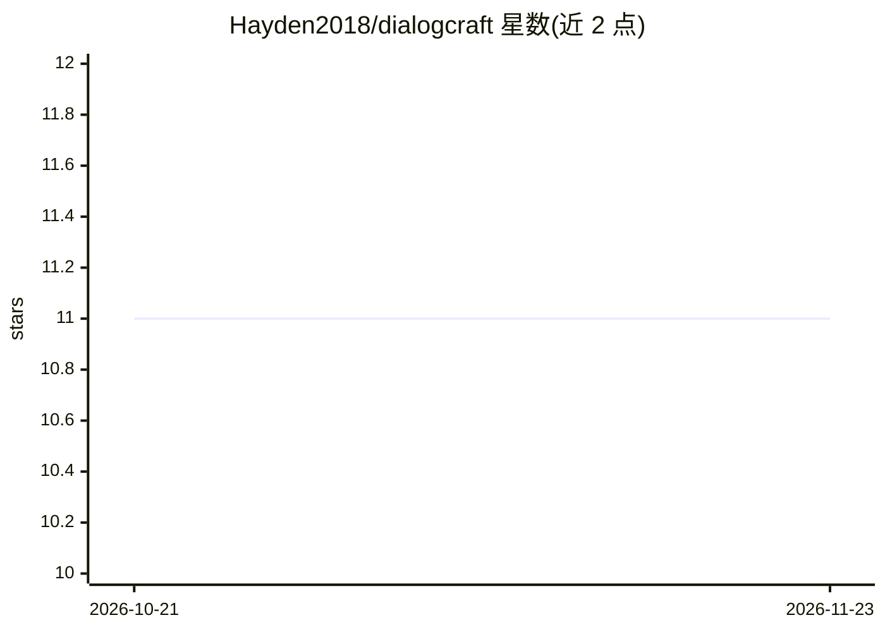

# Hayden2018/dialogcraft

⭐ 11 · TypeScript · MIT · 推送 2026-08-30 · [GitHub](https://github.com/Hayden2018/dialogcraft) · 个人维护

**连接 OpenRouter 的桌面端 AI 对话客户端**

基于 React 与 Electron 构建的桌面/网页聊天应用，通过 OpenRouter API 与 AI 模型对话。API 凭据存储在本地，支持配置兼容 base URL；可编辑删除消息、一键重新生成回复，切换 OpenRouter 账户下的模型并调节 temperature、top P、reasoning effort 等参数，设置最大上下文消息数控制成本；对返回思考 token 的模型单独展示可折叠推理过程；桌面版支持 JSON 格式导入导出聊天记录。v1.1.0 起默认端点从 OpenAI 切换为 OpenRouter，当前提供 Windows 与 Ubuntu 安装包。

## 筛选速览

| 维度 | 判定 | 备注 |
|---|---|---|
| AI 角色 | `ai-ecosystem` | LLM/agent 周边工具 |
| 许可风险 | `permissive` | MIT |
| 部署形态 | `desktop` | 安装包/桌面程序 |
| 模型依赖 | locked-api |  |
| 硬件要求 | — | 无带数字的原话,不猜 |
| 安装摩擦 | `low` | 无编译、无系统依赖或容器化 |
| 成熟度 | — | 结构信号不足 |

## 能力要点

- 本地存储 API 凭据，支持自定义兼容 base URL
- 可切换模型并调节 temperature/top P/reasoning effort 参数
- 思考 token 以可折叠推理区块单独展示
- JSON 格式聊天记录导入导出（桌面版）

## 适用场景

- 用自有 OpenRouter 账户在桌面端管理多轮对话
- 在多个模型间切换并控制生成参数与成本
- 导出备份本地聊天历史

## 场景标签

`聊天机器人` · 领域:对话与助手

## 证据(README 行号)

> L5: DialogCraft is an application built to interact seamlessly with the OpenRouter API. It provides a user-friendly inte
> L30: DialogCraft is built using React with Redux-Saga + Material UI for the user interface and Electron for desktop inte

## 星数曲线

2026-10-21 11 → 2026-11-23 11（+0）

---
*卡片 v1 · prompt 1.4 · 生成 2026-11-19 · 置信度 high · 依据 README sha `3dd5b748e49d` · [字段定义](../../DATASET.md)*
