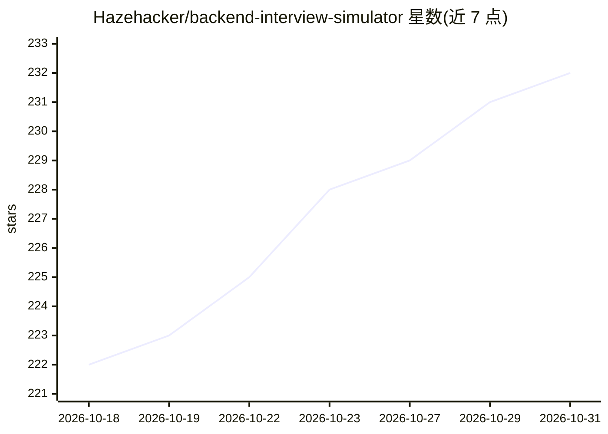

# Hazehacker/backend-interview-simulator

⭐ 232 · MIT · 推送 2026-07-31 · [GitHub](https://github.com/Hazehacker/backend-interview-simulator) · 个人维护 · 中文 README

**模拟中国大厂后端面试的 AI 面试官 Skill**

基于 OpenClaw Skill 规范构建的 SKILL.md 格式面试模拟技能，兼容 Claude Code、QClaw、WorkBuddy 等平台运行。用自然语言与 AI 面试官对话，覆盖 Java/C++/Go 及混合语言；支持日常实习到社招 1-3 年四种身份、六种面试官风格、严格/即时引导两种纠错模式。面试全程维护结构化状态避免重复提问，简历与 JD 关键词自动生成 3-5 层追问链，结束后输出多维度评分与 JD 匹配度分析。局限：不做精确计时，不支持实时语音。

## 筛选速览

| 维度 | 判定 | 备注 |
|---|---|---|
| AI 角色 | `ai-native` | 本体是模型或模型工具 |
| 许可风险 | `permissive` | MIT |
| 部署形态 | `None` |  |
| 模型依赖 | — | README 未给出锁定关系 |
| 硬件要求 | — | 无带数字的原话,不猜 |
| 安装摩擦 | `low` | 无编译、无系统依赖或容器化 |
| 成熟度 | — | 结构信号不足 |

## 能力要点

- 四种求职身份与六种面试官风格可定制
- 简历/JD 关键词自动触发 3-5 层追问链
- 结构化状态跟踪与综合评估报告输出
- 兼容 OpenClaw Skills 规范，多平台（Claude Code/QClaw/WorkBuddy 等）可运行

## 适用场景

- 应届生或实习生模拟字节、腾讯等大厂后端面试
- 社招候选人按目标岗位 JD 定制练习并查看匹配度分析
- 用语音转文字方式按真实面试节奏练习

## 场景标签

`聊天机器人` · 领域:对话与助手

## 证据(README 行号)

> L5: 使用自然语言与 AI 面试官互动，模拟真实中国大厂（字节、腾讯、阿里、美团、快手）后端技术面试。支持按求职者身份和面试官风格定制，全程记录状态并输出结构化评估报告。
> L121: 本项目基于 **OpenClaw Skill 框架**构建，采用三层加载架构：

## 星数曲线

2026-10-18 222 → 2026-10-31 232（+10）

---
*卡片 v1 · prompt 1.4 · 生成 2026-10-22 · 置信度 high · 依据 README sha `b6e4f2acc915` · [字段定义](../../DATASET.md)*
