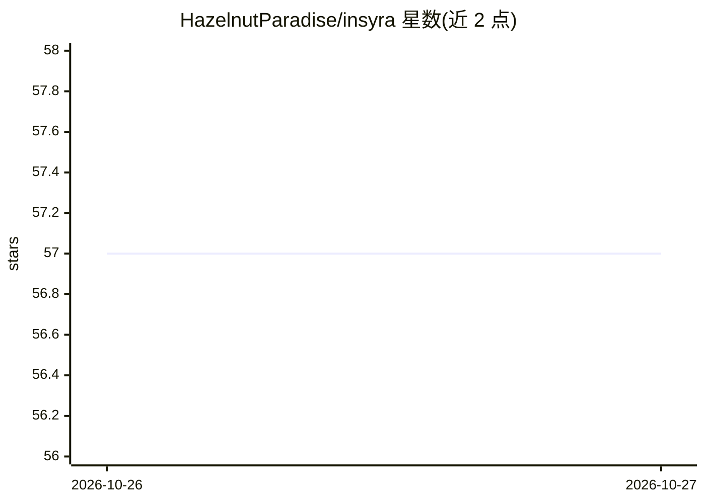

# HazelnutParadise/insyra

⭐ 57 · Go · MIT · 推送 2026-10-26 · [GitHub](https://github.com/HazelnutParadise/insyra) · [官网](https://insyra.hazelnut-paradise.com) · 个人维护 · 中文 README

**Go 语言数据分析生态库：数据处理、统计、机器学习与神经网络**

面向 Go 开发者的纯 Go 数据分析库，覆盖数据加载清洗、统计、可视化、机器学习与深度学习。提供 DataList/DataTable 核心结构、类 Excel 公式的列计算语言（CCL）、Parquet 流式读写与 Python 互操作。ml 包提供 scikit-learn 风格建模并导出 ONNX；nn 包含 autodiff 训练引擎，可加载已发布 ONNX 模型与 SafeTensors 权重，GPU 经纯 Go WebGPU 后端跑在 Metal/Vulkan/DX12 上并支持 CPU 回退。附带 CLI 与 REPL，附面向 AI agent 的技能包。README 声明部分未列入文档的功能仍在开发中，结果可能不稳定。

## 筛选速览

| 维度 | 判定 | 备注 |
|---|---|---|
| AI 角色 | `ai-native` | 本体是模型或模型工具 |
| 许可风险 | `permissive` | MIT |
| 部署形态 | `library` | 以包/库形式分发 |
| 模型依赖 | — | README 未给出锁定关系 |
| 硬件要求 | — | 无带数字的原话,不猜 |
| 安装摩擦 | `low` | 无编译、无系统依赖或容器化 |
| 成熟度 | `idea` | |

## 能力要点

- 纯 Go 实现的 ml（回归/树模型/交叉验证）与 nn（autodiff + ONNX/SafeTensors）模块，无 cgo 与 Python 运行时
- CCL 列计算语言可在读取 Parquet 时于源头过滤与变换数据
- GPU 加速经 WebGPU 后端支持 Metal/Vulkan/DirectX 12，无设备时回退 CPU
- 自带 CLI 与 REPL，并提供 Idensyra 迷你 IDE 与 Syralit 数据应用框架

## 适用场景

- 在 Go 项目中完成从 CSV/Parquet 加载到统计分析的完整流程
- 不依赖 Python 环境在 Go 内训练与运行神经网络模型
- 通过 CLI/REPL 快速做交互式数据探索

## 场景标签

`数据分析` · 领域:效率与自动化

## 证据(README 行号)

> L13: **Insyra** is a complete data analysis ecosystem for Go, spanning data loading and cleaning, statistics, visualizat
> L46: - **`ml`** gives you scikit-learn-style modeling: regressions (linear, ridge, lasso, logistic), decision trees, ran
> L48:  - **Run real models.** Published ONNX checkpoints load and run unmodified: MobileNetV2, MiniLM (a BERT-class encod

## 星数曲线

2026-10-26 57 → 2026-10-27 57（+0）

---
*卡片 v1 · prompt 1.4 · 生成 2026-10-27 · 置信度 mid · 依据 README sha `f7c23d85f569` · [字段定义](../../DATASET.md)*
