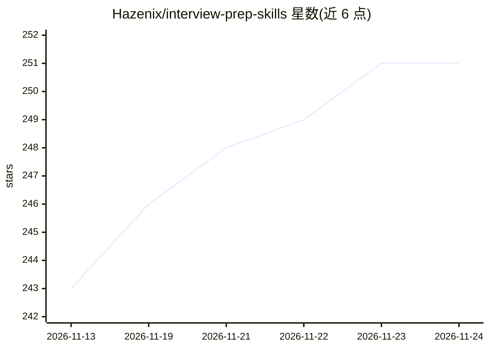

# Hazenix/interview-prep-skills

⭐ 251 · MIT · 推送 2026-11-16 · [GitHub](https://github.com/Hazenix/interview-prep-skills) · 个人维护 · 中文 README

**技术面试准备 Agent Skills 集合：简历提炼、出题与模拟面试**

面向求职者（实习、校招、社招 1–3 年）的 Agent Skills 合集，包含 5 个可独立使用的 SKILL.md 格式技能：从项目材料提炼中文简历条目（resume-bullets）、按简历条目批量生成主问题与追问的 Markdown 题单（resume-interview-question-generator），以及前端、Java/Go/C++ 后端和 AI 应用开发三个模拟面试 skill。模拟面试支持多身份、六种面试官风格、逐轮追问与分维度反馈。安装方式为让支持 Agent Skills 的 AI 工具从 GitHub 仓库读取并写入 skill 目录。

## 筛选速览

| 维度 | 判定 | 备注 |
|---|---|---|
| AI 角色 | `ai-knowledge` | 知识聚合/清单类 |
| 许可风险 | `permissive` | MIT |
| 部署形态 | `None` |  |
| 模型依赖 | — | README 未给出锁定关系 |
| 硬件要求 | — | 无带数字的原话,不猜 |
| 安装摩擦 | `low` | 无编译、无系统依赖或容器化 |
| 成熟度 | — | 结构信号不足 |

## 能力要点

- 5 个可独立使用的 skill：简历条目打磨、简历批量出题、前端/后端/AI 应用开发模拟面试
- 模拟面试提供多身份（实习/校招/社招）与六种面试官风格，逐轮追问并给出分维度反馈
- 题库覆盖前端、Java/Go/C++ 后端及 LLM/Agent/RAG/MCP 等 AI 应用开发方向
- AI 应用开发方向可围绕检索、重排与评估等细节追问并加入实操题

## 适用场景

- 求职者从项目或实习材料提炼可写进简历的量化条目
- 按自己的简历条目提前生成面试官可能问的主问题和追问
- 求职者进行前端、后端或 AI 应用开发方向的模拟面试练习

## 场景标签

`AI 助手` · 领域:对话与助手

## 证据(README 行号)

> L7: **从写简历到练面试。** 有项目材料时，可以先提炼中文简历条目。选好要写进简历的条目后，可以生成 Markdown 题单，提前准备面试官可能问的主问题和追问。
> L9: 想练临场回答时，可以选前端、Java/Go/C++ 后端或 AI 应用开发模拟面试。AI 会根据你的回答逐轮追问，结束后给出反馈。每个 skill 都可以单独使用。
> L21: 把下面这段话发给支持 Agent Skills、能读取 GitHub 仓库并写入 skill 目录的 AI 工具。

## 星数曲线

2026-11-13 243 → 2026-11-24 251（+8）

---
*卡片 v1 · prompt 1.4 · 生成 2026-11-17 · 置信度 mid · 依据 README sha `f98c91139b61` · [字段定义](../../DATASET.md)*
