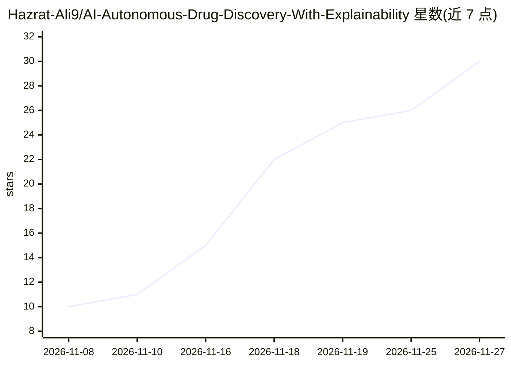

# Hazrat-Ali9/AI-Autonomous-Drug-Discovery-With-Explainability

⭐ 30 · 推送 2026-08-18 · [GitHub](https://github.com/Hazrat-Ali9/AI-Autonomous-Drug-Discovery-With-Explainability) · [官网](https://github.com/Hazrat-Ali9/AI-Autonomous-Drug-Discovery-With-Explainability) · 个人维护

**药物发现 AI 平台：分子预测、生成与可解释决策**

Python 实现的计算药物发现项目，整合分子属性预测（生物活性、ADMET、毒性）、深度学习生成新分子与骨架优化、SHAP/LIME/Captum 可解释 AI，以及含文献检索与自动化假说生成的研究助手，并提供分子可视化与研究分析面板。技术栈基于 PyTorch/TensorFlow/RDKit/DeepChem，部署涉及 FastAPI/Streamlit/Docker。README 未给出具体安装运行命令，面向计算药物发现研究者与医药数据科学场景。

## 筛选速览

| 维度 | 判定 | 备注 |
|---|---|---|
| AI 角色 | `ai-native` | 本体是模型或模型工具 |
| 许可风险 | `none` | — |
| 部署形态 | `None` |  |
| 模型依赖 | — | README 未给出锁定关系 |
| 硬件要求 | — | 无带数字的原话,不猜 |
| 安装摩擦 | `low` | 无编译、无系统依赖或容器化 |
| 成熟度 | — | 结构信号不足 |

## 能力要点

- 分子属性预测：生物活性、结合亲和力、ADMET 与毒性评估
- 深度学习生成新分子与骨架优化、化学空间探索
- SHAP/Captum/LIME 可解释性分析
- 含文献知识检索与自动化假说生成的 AI 研究助手

## 适用场景

- 虚拟筛选与小分子候选化合物发现
- 预测分子 ADMET 与毒性属性并解释模型决策
- 药物重定位与精准医学研究中的可解释建模

## 场景标签

`科研工具` · 领域:学习与行业

## 证据(README 行号)

> L3: AI-Autonomous-Drug-Discovery-With-Explainability is a next-generation AI platform that combines autonomous drug disc
> L19: Bioactivity and binding affinity estimation
> L35: Novel molecule generation using deep learning

## 星数曲线

2026-11-08 10 → 2026-11-27 30（+20）

---
*卡片 v1 · prompt 1.4 · 生成 2026-11-18 · 置信度 mid · 依据 README sha `30de77da6c26` · [字段定义](../../DATASET.md)*
