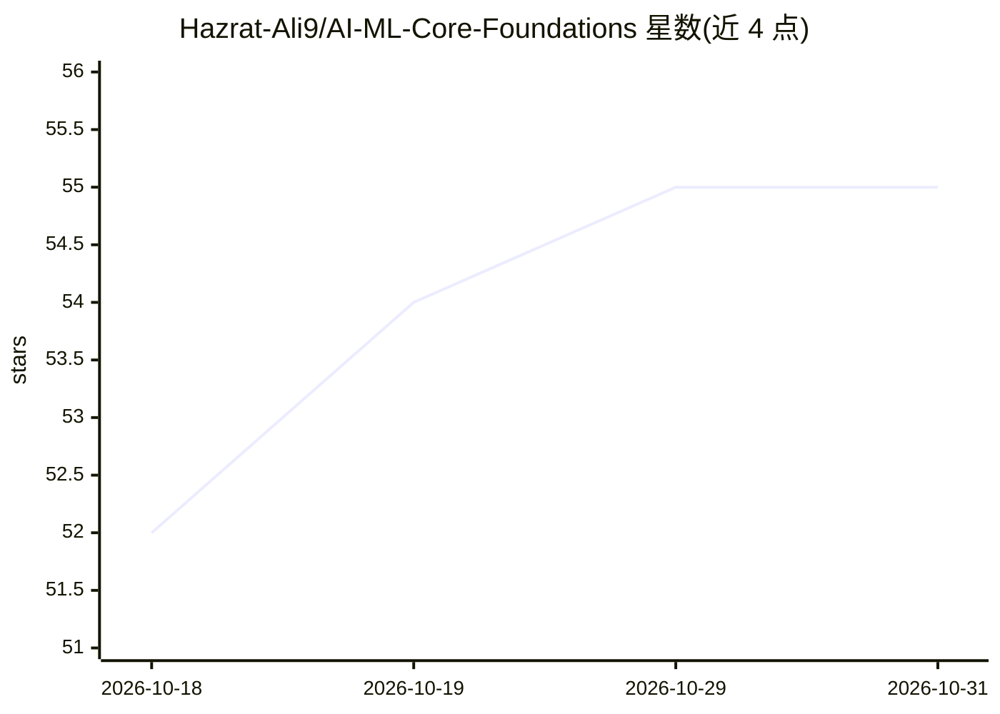

# Hazrat-Ali9/AI-ML-Core-Foundations

⭐ 55 · Jupyter Notebook · 推送 2026-10-29 · [GitHub](https://github.com/Hazrat-Ali9/AI-ML-Core-Foundations) · [官网](https://github.com/Hazrat-Ali9/AI-ML-Core-Foundation) · 个人维护

**AI/ML 基础学习仓库：数学、算法与实践代码合集**

面向 AI/ML 初学者的教学型代码仓库：按目录组织线性代数/统计等数学基础、数据预处理、回归/分类/聚类/降维算法、模型评估指标与神经网络入门，配套 Jupyter Notebook 练习和小项目。技术栈为 Python 与 NumPy、Pandas、Scikit-learn、Matplotlib、Seaborn，TensorFlow/PyTorch 为可选。通过 git clone 后在 Jupyter Notebook 中运行，MIT 许可。

## 筛选速览

| 维度 | 判定 | 备注 |
|---|---|---|
| AI 角色 | `ai-knowledge` | 知识聚合/清单类 |
| 许可风险 | `none` | — |
| 部署形态 | `None` |  |
| 模型依赖 | — | README 未给出锁定关系 |
| 硬件要求 | — | 无带数字的原话,不猜 |
| 安装摩擦 | `low` | 无编译、无系统依赖或容器化 |
| 成熟度 | — | 结构信号不足 |

## 能力要点

- 覆盖数学基础、预处理、监督/无监督算法、评估与神经网络的目录结构
- 基于 Scikit-learn、NumPy、Pandas、Matplotlib 的实践实现
- Jupyter Notebook 练习题与迷你项目

## 适用场景

- 初学者系统学习 ML 数学与算法基础并动手实践
- 开发者转行数据科学/机器学习时的入门练习材料
- 研究者快速搭建 ML 原型参考代码

## 场景标签

`教程课程` · 领域:学习与行业

## 证据(README 行号)

> L7: AI-ML-Core-Foundations is a comprehensive repository that provides a solid starting point for Artificial Intelligenc
> L23: 🧩 Hands-On Exercises: Jupyter notebooks with examples and practice problems

## 星数曲线

2026-10-18 52 → 2026-10-31 55（+3）

---
*卡片 v1 · prompt 1.4 · 生成 2026-10-24 · 置信度 high · 依据 README sha `2506dad58f4f` · [字段定义](../../DATASET.md)*
